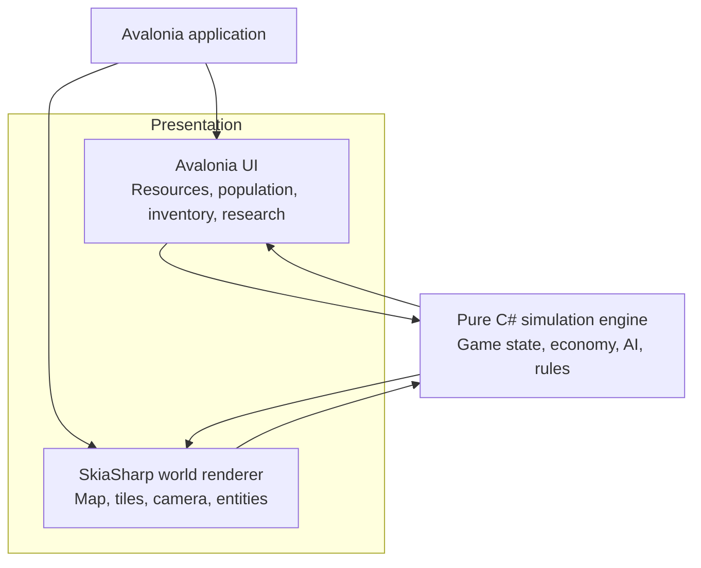
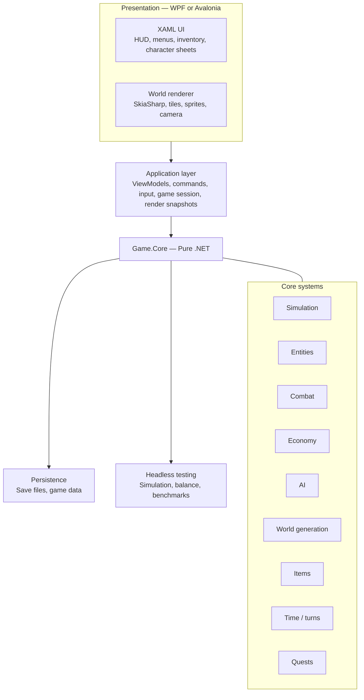
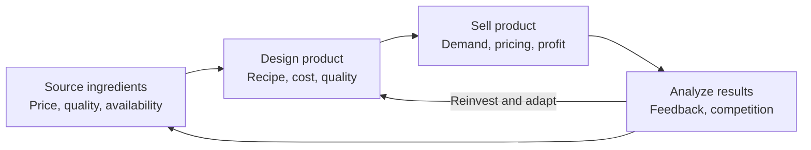

# Game Framework Comparison

Source: https://chatgpt.com/share/6b066516-072c-83e9-a1f8-35e87397792d

## User

i want to make a game with C#/dotnet and there's a lot of new options here. i've used xna/monogame before, i've done C++/directx before, and i've done extensive WPF development. i'm just making this for fun, but what are my reasonably good, ergonomic options here? i see maui and blazor, or i could just do monogame, wpf, or SDL. thoughts/pros/cons?

## Assistant

I'll compare game-focused frameworks with UI frameworks, particularly where your existing XNA and WPF experience would make development easier.

## Assistant

Given your experience with XNA/MonoGame, C++/DirectX, and extensive WPF development, you're in an interesting position: you don't necessarily need a full game engine, and you already know enough about rendering and application architecture to be productive with a lightweight framework.

For a hobby project, I'd optimize for **developer ergonomics, iteration speed, and how much of your time you actually spend making the game versus building the infrastructure around it.**

There are three broad categories worth considering:

- **Game frameworks:** MonoGame, Raylib, SDL, FNA — code-first, explicit control, minimal architectural constraints.
- **Game engines:** Godot, Unity, Stride — integrated tooling, rendering, physics, UI, animation and scene management.
- **Application frameworks:** WPF, Avalonia, MAUI, Blazor — excellent for interface-heavy games, less suited to conventional real-time games.

## High-level comparison

These are my subjective ratings for a hobby project, taking your existing experience into account.

| Framework | Getting started | Real-time 2D | 3D | UI development | Code-first |
|---|---|---|---|---|---|
| MonoGame | Excellent | Excellent | Good | Fair | Excellent |
| Raylib-cs | Excellent | Excellent | Good | Fair | Excellent |
| Godot C# | Good | Excellent | Excellent | Excellent | Good |
| SDL3 | Fair | Excellent | Good* | Poor | Excellent |
| WPF | Excellent | Fair | Fair | Excellent | Excellent |
| Avalonia | Excellent | Good | Fair* | Excellent | Excellent |
| Blazor | Good | Fair | Poor* | Excellent | Excellent |
| MAUI | Fair | Fair | Poor* | Good | Good |
| Stride | Good | Good | Excellent | Good | Good |
| Unity | Good | Excellent | Excellent | Excellent | Good |

\* With additional rendering APIs, libraries or infrastructure.

## 1. Game frameworks

### [MonoGame](https://monogame.net/) — Best all-around code-first option

MonoGame is still very much alive. The 3.8.6 release series is available, and the surrounding ecosystem has improved considerably since the XNA days. 

**Pros**
- Practically zero learning curve for you.
- Complete control over game architecture.
- Conventional .NET development experience.
- Cross-platform desktop, mobile and console support.
- Predictable game loop and rendering behavior.
- Mature sprite batching, shaders, audio and input handling.

**Cons**
- Content pipeline can be cumbersome.
- No integrated scene or level editor.
- You'll need to assemble some higher-level systems yourself.
- Building sophisticated UI from scratch is tedious.

However, two libraries substantially improve the experience:

| Library | Purpose |
|---|---|
| [MonoGame.Extended](https://www.monogameextended.net/) | Cameras, tilemaps, collision detection, ECS and geometry |
| [Gum](https://docs.flatredball.com/gum) | UI layout, controls, themes and visual designer |
| [FontStashSharp](https://github.com/FontStashSharp/FontStashSharp) | Dynamic font rendering |
| [LDtk](https://ldtk.io/) | External 2D level editor |
| [Aether.Physics2D](https://github.com/tainicom/Aether.Physics2D) | 2D physics |

Gum is particularly interesting given your WPF background. It provides a layout engine, reusable controls, a visual designer and code-only UI development. MonoGame's own tutorials now cover integrating it. 

**My assessment:** Probably your safest choice. You can start building gameplay immediately without learning an entirely new development paradigm.

### [Raylib-cs](https://github.com/raylib-cs/raylib-cs) — Best lightweight alternative

This is probably the new option I'd most encourage you to explore.

Raylib is a remarkably straightforward graphics and game programming library. Its C# bindings currently target .NET 8 and .NET 10. 

A complete working application looks like this:

```csharp
using Raylib_cs;

Raylib.InitWindow(1280, 720, "My Game");

while (!Raylib.WindowShouldClose())
{
    float dt = Raylib.GetFrameTime();

    // Update game state

    Raylib.BeginDrawing();
    Raylib.ClearBackground(Color.Black);

    Raylib.DrawCircle(640, 360, 50, Color.Red);
    Raylib.DrawText("Hello World", 20, 20, 24, Color.White);

    Raylib.EndDrawing();
}

Raylib.CloseWindow();
```

**Pros**
- Extremely low ceremony.
- Ordinary .NET console project with a NuGet dependency.
- No mandatory content pipeline.
- Load assets directly from disk.
- Built-in 2D and 3D drawing primitives, cameras, shaders, models and audio.
- No editor, inheritance hierarchy or prescribed architecture.

**Cons**
- C-style API rather than idiomatic C#.
- Native resource lifetime management requires attention.
- Smaller C# ecosystem than MonoGame.
- You'll build more of your own higher-level abstractions.

**My assessment:** If you enjoy writing code more than configuring tools, Raylib is arguably the most fun option on this list. It feels like the simplicity of XNA with even less ceremony.

### [SDL3](https://www.libsdl.org/) — Best for building your own engine

SDL3 is considerably more interesting than SDL2 because it now includes a modern cross-platform GPU API. C# bindings are available, including `ppy.SDL3-CS`. 

**Pros**
- Excellent control over rendering and execution.
- Cross-platform windowing, input and audio.
- Hardware-accelerated 2D rendering.
- Modern GPU abstraction over Direct3D 12, Vulkan and Metal.
- Minimal architectural constraints.

**Cons**
- More native interop.
- More infrastructure to implement.
- Less idiomatic .NET experience.
- You'll be responsible for substantially more resource management.

I'd also put [Silk.NET](https://github.com/dotnet/Silk.NET) and OpenTK in this general category.

**My assessment:** Choose SDL if building the underlying technology is part of what you find fun. Otherwise, MonoGame or Raylib will get you further in less time.

## 2. Full game engines

### [Godot .NET](https://godotengine.org/) — Best integrated option

Godot would be my first choice if you wanted to try a proper game engine rather than a framework.

**Pros**
- Open source and MIT licensed.
- Excellent dedicated 2D engine.
- Capable 3D engine.
- Built-in physics, animation, particles, lighting and navigation.
- Integrated scene and tilemap editors.
- Excellent UI layout and theming system.
- C# support with external IDE debugging.

**Cons**
- Learning the node and scene architecture.
- Many community examples are written in GDScript.
- Some friction between managed C# objects and native engine objects.
- Godot 4's stable C# support currently doesn't include browser exports. 

Interestingly, a lot of Godot's UI concepts should feel familiar to you coming from WPF.

| WPF | Godot equivalent |
|---|---|
| Visual tree | Scene tree |
| FrameworkElement | Control |
| StackPanel | VBoxContainer / HBoxContainer |
| UserControl | Reusable scene |
| Styles | Themes |
| Routed events | Signals (roughly) |
| Dependency property editing | Exported properties (roughly) |

They're not exact equivalents, but the mental models overlap.

**My assessment:** If you're making something ambitious with animation, physics, complex environments or lots of visual assets, Godot may save you hundreds of hours. If you're making a primarily algorithmic game, its architecture might be more than you need.

### [Stride](https://www.stride3d.net/) — Most interesting .NET-centric 3D engine

Formerly Xenko, Stride is a free, open-source C# engine that currently supports .NET 10. It also has a code-only development approach available through its community toolkit. 

**Pros**
- Deep integration with C# and .NET.
- Modern 3D rendering pipeline.
- Entity-component architecture.
- Visual editor available but code-only development is possible.
- Open source.

**Cons**
- Much smaller community than Godot or Unity.
- Fewer tutorials and third-party assets.
- More complexity than necessary for simple 2D games.

**My assessment:** Worth seriously exploring if you want to make a 3D game while remaining in a relatively conventional .NET ecosystem.

### [Unity](https://unity.com/) — Most comprehensive option

Unity remains a very capable choice, but I wouldn't automatically recommend it for you.

Its greatest strengths are its mature tooling, asset ecosystem, extensive documentation and breadth of functionality. Its disadvantages are editor overhead, engine-specific workflows, complexity and a less conventional .NET development experience.

For a personal project where programming is part of the enjoyment, I'd try Godot before Unity.

## 3. Application frameworks

These are more viable than traditional game developers might suggest, particularly depending on the genre.

### WPF — Still a perfectly legitimate option

I wouldn't dismiss WPF simply because it's an older technology.

Imagine developing a game like:

- Civilization
- Slay the Spire
- Football Manager
- Cookie Clicker
- A business or economic simulator
- A text-based RPG
- A turn-based tactics game

WPF could be exceptionally productive for these.

**Pros:** MVVM, binding, layout, templates, styles, animation, typography, virtualization and an ecosystem you already understand extensively.

**Cons:** Windows only, retained-mode rendering overhead, UI-thread contention, no traditional game loop, and limited game-specific facilities.

You can also mix rendering approaches:

| Rendering approach | Suitable for |
|---|---|
| XAML controls | Menus, inventory, statistics |
| Canvas | Small interactive game boards |
| DrawingVisual / OnRender | Larger 2D game boards |
| SkiaSharp | Custom 2D rendering |
| Direct3D interop | Advanced GPU rendering |

The mistake would be representing 20,000 moving game entities as individual WPF controls. There's nothing inherently wrong with using WPF for the interface and a custom rendering surface for the world.

### [Avalonia](https://avaloniaui.net/) — The modern WPF-like option

**This is the most important application framework missing from your original list.**

Avalonia is a cross-platform XAML UI framework with many familiar WPF concepts. It uses its own rendering system and supports custom drawing, including direct access to SkiaSharp's canvas. 

**Pros**
- Much of your WPF experience transfers directly.
- Windows, Linux and macOS support, among other targets.
- MVVM and data binding.
- Styles, templates and reusable controls.
- Custom 2D rendering capabilities.
- Excellent for complex, interface-heavy games.

**Cons**
- Still fundamentally a UI framework.
- Some differences from WPF's binding and styling systems.
- Game-specific input, audio and timing require additional work.
- Not ideal for large real-time sprite workloads or 3D worlds.

I particularly like this potential architecture:



For a strategy or management game, I'd seriously consider this over MonoGame.

### Blazor — Best for easily sharing a game

Blazor is especially interesting if you want people to play your game by simply visiting a URL.

I'd specifically consider **Blazor WebAssembly**, not Blazor Server, for the game client. WebAssembly runs the .NET application locally in the browser, and browser APIs are accessible through JavaScript interop. 

**Pros**
- Entire game logic can be written in C#.
- No installation required for players.
- Razor components and CSS for sophisticated interfaces.
- Straightforward static hosting for standalone WebAssembly.
- Excellent for turn-based, card, puzzle and idle games.
- Easy integration with an ASP.NET Core multiplayer backend.

**Cons**
- DOM rendering isn't designed for high-frequency game rendering.
- Canvas or WebGL typically requires interop or additional libraries.
- WebAssembly startup overhead.
- Browser restrictions and runtime limitations.
- CSS and HTML introduce another set of skills and abstractions.

You can also use Blazor Hybrid to package a native application whose UI is rendered inside a WebView.

**My assessment:** If you were making an online board game, deck builder or incremental game, I'd rate Blazor highly. For an action RPG or platformer, considerably less so.

### .NET MAUI — Probably not worth it

MAUI does provide `GraphicsView` for custom 2D drawing and supports Windows, Android, iOS and macOS through Mac Catalyst. 

However, I don't see much advantage for your use case unless mobile deployment and native application controls are both important.

You would introduce platform-specific handlers, workload dependencies, native control differences and additional deployment complexity without gaining much in the way of game development capabilities.

I'd choose Avalonia over MAUI for a desktop-oriented game, and MonoGame or Godot for a conventional mobile game.

## What I would choose by genre

| Game type | First choice | Second choice |
|---|---|---|
| 2D platformer | MonoGame | Godot |
| Top-down RPG | MonoGame | Godot |
| Roguelike | Raylib | MonoGame |
| Factory automation | MonoGame | Raylib |
| City builder | MonoGame | Avalonia + SkiaSharp |
| Economic simulator | Avalonia | WPF |
| Grand strategy | Avalonia + SkiaSharp | MonoGame + Gum |
| Deck builder | Godot | Avalonia |
| Idle / incremental | Blazor | Avalonia |
| Online board game | Blazor | Godot |
| Physics sandbox | Godot | Raylib |
| 3D RPG | Godot | Unity |
| 3D graphics experimentation | Stride | SDL3 |
| Custom engine development | SDL3 | Silk.NET |

## My shortlist for you

  
    
    
      **1. MonoGame + Gum + MonoGame.Extended**

      Best balance of familiarity, control, maturity and functionality. A substantially more complete development experience than bare XNA.
    
  
  
  
    
    
      **2. Raylib-cs**

      Best for uncomplicated, pure programming enjoyment. Very little stands between your code and what appears on screen.
    
  
  
  
    
    
      **3. Avalonia + SkiaSharp**

      Best for leveraging your WPF expertise while building something modern, cross-platform and UI-intensive.
    
  
  
  
    
    
      **4. Godot .NET**

      Best when you'd rather focus on creating game content than implementing the systems that support it.
    
  

Regardless of which one you choose, I'd keep the core game logic in a plain .NET class library, independent of the rendering framework. That would give you ordinary unit testing, deterministic simulation where appropriate, and the flexibility to experiment with different frontends without throwing away your work.

I'd also resist the temptation to build a generic game engine before building the game. As an experienced software engineer, that's probably one of the easier rabbit holes to fall into.

**What kind of game are you thinking about making?** I'm particularly curious about three things:

- 2D, isometric or 3D?
- Real-time action, or more of a simulation/strategy game?
- Do you enjoy implementing the underlying engine systems, or would you rather spend your time developing gameplay mechanics?

Those answers could dramatically change my recommendation. I could see Avalonia being your best option just as easily as MonoGame, depending on the game.

## User

im probably leaning towards a simulation/turn-based/rpg style game. ive actually developed a business simulation game in WPF before, and I also professionally worked on Adera and Disney Fairies which used WinRT/XAML interop with DX, so I'm familiar with that. That's why WPF seems so appealing to me.

## Assistant

That changes my recommendation quite a bit. Given the type of game you're considering, and your professional experience with XAML/DirectX interoperability, **I would put WPF and Avalonia at the top of your list, ahead of MonoGame.**

Simulation and turn-based RPGs tend to be disproportionately UI-heavy. Consider how much of your development time might be spent implementing:

- Inventory systems, equipment screens and character sheets.
- Skill trees, tooltips and contextual menus.
- Economic systems, charts and statistics.
- Dialogues, quests and notifications.
- Scrollable lists, searchable tables and nested menus.
- Game settings, save management and customization.

All of that is relatively trivial with XAML, data binding, commands, styles and templates. With a traditional game framework, even with a good UI library, there's considerably more work involved.

The interesting question isn't whether WPF is capable enough. It's whether there's a modern alternative that provides the same development experience without some of WPF's limitations.

## WPF vs. Avalonia vs. WinUI 3

I'd narrow your investigation to these three.

| Capability | WPF | Avalonia | WinUI 3 |
|---|---|---|---|
| Your existing familiarity | Excellent | Very high | High |
| Cross-platform | No | Yes | No |
| MVVM | Excellent | Excellent | Excellent |
| Data binding | Runtime | Compiled available | Compiled available |
| Custom control development | Excellent | Excellent | Good |
| Custom 2D rendering | Good | Excellent | Excellent |
| DirectX interoperability | Legacy | Available, more involved | First-class |
| Deployment simplicity | Excellent | Good | Fair |
| Framework maturity | Excellent | Very good | Good |
| Modern .NET support | Yes | Yes | Yes |

### WPF + SkiaSharp

This might be the lowest-friction option for you. Rather than immediately reaching for DirectX interoperability, you could use SkiaSharp for custom rendering.

SkiaSharp provides two WPF controls out of the box:

- `SKElement` — CPU-rendered drawing surface.
- `SKGLElement` — hardware-accelerated rendering through OpenGL. 

You could essentially have a hardware-accelerated 2D game surface embedded directly in your existing XAML hierarchy.

```xml

    <skia:SKGLElement
        PaintSurface="RenderWorld" />

    <local:GameHUD />

    <local:InventoryPanel
        HorizontalAlignment="Right"

```

This gives you a fairly powerful hybrid approach without managing DirectX devices, swap chains, shaders or shared surfaces yourself.

Alternatively, native WPF `DrawingVisual` objects are much lighter than standard WPF controls because they don't participate in layout or event handling. For a modest turn-based game, you might not even need SkiaSharp. 

### Avalonia + SkiaSharp

This is the option I'd be most interested in experimenting with if I were in your position.

Avalonia is not merely a cross-platform imitation of WPF. There are some genuinely attractive improvements:

- Compile-time checked data bindings.
- CSS-inspired styling with selectors and pseudoclasses.
- Direct access to the underlying Skia rendering canvas.
- Render-thread animation callbacks.
- Cross-platform GPU composition.
- Familiar XAML, MVVM and control templating.

Avalonia even explicitly documents its `CompositionCustomVisualHandler` as suitable for game loops and real-time visualizations on the render thread. 

You could implement your entire world renderer as a custom Avalonia control without introducing a separate graphics framework.

The downside is that you'll have to unlearn some WPF-specific behaviors, particularly around styling and the property system. But most of your experience should translate directly.

### WinUI 3 + DirectX

Given your experience working on Adera and Disney Fairies, this deserves a mention.

WinUI 3 still supports `SwapChainPanel` and native DirectX interoperability, along with native composition APIs. 

It's arguably the closest modern equivalent to the architecture you worked with professionally.

However, unless you're specifically interested in doing sophisticated GPU rendering, I don't think the Windows App SDK and interop complexity are worth introducing for a hobby project. I'd prefer WPF or Avalonia for general development ergonomics.

## How I would architect the game

I'd build something that is fundamentally a .NET application with a simulation engine, rather than a rendering engine with a simulation attached to it.



One particularly nice aspect of this approach is that you don't need to couple your simulation to a 60 FPS game loop.

For example, you can simulate an entire year of economic activity in a unit test, benchmark your NPC decision-making, or run 10,000 combat encounters to assess balancing without ever initializing the UI.

For a turn-based game, the world renderer could even be entirely invalidation-driven, only continuously rendering during animations or camera movement.

## Where this approach makes sense

  
  
    **RimWorld / Dwarf Fortress**

    Custom-rendered world, independent simulation clock, extensive data-bound UI.
  

  
  
    **Crusader Kings / Civilization**

    Custom map renderer with sophisticated XAML panels, tooltips and navigation.
  

  
  
    **Battle Brothers / Turn-based tactical RPG**

    Sprite-based combat surface with character management, inventories and equipment.
  

  
  
    **Capitalism Lab / Business simulation**

    Almost entirely XAML, with custom charts and visualization controls where necessary.
  

These are examples of game styles that would lend themselves to the architecture, not games necessarily implemented using these technologies.

## My preferred technology stack

If you were starting from scratch tonight, I'd suggest:

| Component | Technology |
|---|---|
| Runtime | .NET 10 LTS |
| Application | Avalonia or WPF |
| MVVM | CommunityToolkit.Mvvm |
| World rendering | SkiaSharp |
| Charts | LiveCharts2 |
| Audio | MiniAudio bindings |
| Serialization | System.Text.Json |
| Persistence | JSON / SQLite, as needed |
| Logging | Microsoft.Extensions.Logging |
| Testing | xUnit |
| Simulation | Plain C# |

No ECS framework, physics engine, dependency injection container or elaborate engine abstraction until you have an actual need for one.

## My recommendation

I'd spend one evening experimenting with Avalonia. Build a small tile-based map with a movable camera, selectable entities, a data-bound information panel and a simulation running independently of rendering.

That exercise should tell you almost everything you need to know about whether you enjoy the framework.

If Avalonia feels natural, I'd stick with it. If you find yourself constantly thinking about how much easier something would have been in WPF, just use WPF.

**I wouldn't choose a dedicated game framework simply because you're making a game.** Your experience is unusually well suited to the hybrid application/game architecture, and for the genres you're considering, it could be considerably more productive.

I'm curious whether you're leaning more toward a RimWorld-style world simulation, a Civilization-style strategy game, a character-driven RPG, or another economic/business simulation. That distinction would largely determine how sophisticated your rendering layer actually needs to be.

## User

i've been really interested in a very deep lemonade-tycoon style simulation game. one that starts with a basic "sell this product, which is made of N components, for $X". then you have to balance the recipe of those N components to create a desirable end product. Then you have to source those N products from ever-changing wholesellers, constantly balancing price, availability, and competitive edge. By competitive edge, suppose we're talking lemonade. Maybe what makes your recipe special is that you get sugar from a certain retailer where the sugar quality is 10/10. Maybe you buy all of it every turn, so nobody else can produce the same lemonade. Then we could even get into logistics: maybe you franchise and need to supply your locations with the components for the recipe, maybe different regions prefer different recipes, etc. This concept can be as deep as I want to make it. Thoughts?

## Assistant

I think there's a genuinely interesting game here, especially if you lean into **competitive advantage emerging from the simulation rather than from predetermined upgrade trees.**

What you're describing starts as Lemonade Tycoon, but could gradually evolve into something resembling Capitalism Lab, Factorio, and Football Manager. The player starts by optimizing a product and eventually ends up managing an entire vertically integrated business.

What I particularly like is that nearly every additional layer of complexity can emerge naturally from the original gameplay loop. You don't need to invent unrelated mechanics to make the late game interesting.

## 1. The core gameplay loop



Even in its most primitive form, this loop has plenty of room for interesting decisions. Every turn should present the player with new information, imperfect choices and opportunities to improve their business.

## 2. Product development and recipes

I would make products a generic concept in the underlying simulation. Lemonade is simply the first product available to the player.

Ingredients could have multiple attributes, rather than just a single quality rating.

| Ingredient | Relevant attributes |
|---|---|
| Lemons | Acidity, sweetness, freshness, juice yield |
| Sugar | Purity, sweetness, flavor profile |
| Water | Mineral content, purity |
| Ice | Purity, melting rate |
| Strawberries | Sweetness, freshness, flavor intensity |
| Cups | Durability, appearance, environmental impact |

The interesting part is that ingredients interact with each other. Expensive ingredients don't necessarily produce a better product. The proportions, compatibility and target consumer all matter.

Here's a simplified example of what a recipe development mechanic could look like.

**Illustrative recipe model**

| Input | Formula or rule |
|---|---|
| Ingredient cost per cup | `0.12 + lemon concentration × 0.006 + sugar × (0.002 + quality × 0.0005)` |
| Customer taste | `82 + quality × 1.8 - distance from target lemon concentration × 0.9 - distance from target sweetness × 0.9` |
| Daily demand | Taste × 1.7 × `exp(-0.65 × (price - 1.5))`, bounded from 0 to 200 |
| Daily gross profit | Daily demand × (retail price - ingredient cost) |

Sugar supplier quality tiers:

| Supplier tier | Quality | Relative cost |
|---|---:|---|
| Budget | 3/10 | Lower |
| Standard | 6/10 | Middle |
| Premium | 10/10 | Higher |

In the actual game, I wouldn't expose all of these results immediately. You should have to conduct market research, experiment with recipes and interpret consumer feedback to understand why something sells well.

That introduces discovery as a gameplay mechanic.

## 3. A living wholesale market

This is where I think your idea really differentiates itself.

Instead of suppliers being static shops with predetermined prices, make them economic entities with their own inventories, capacity, costs and constraints.

**Wholesale market — Day 24**

Illustrative market state for sugar:

| Supplier | Quality | Price/lb | Stock | Trend |
|---|---:|---:|---:|---:|
| Valley Farms | 10/10 | $1.20 | 80 lb | +12% |
| Golden Harvest | 8/10 | $0.85 | 420 lb | +4% |
| National Sugar | 6/10 | $0.59 | 2,400 lb | -3% |
| Economy Foods | 3/10 | $0.32 | 800 lb | 0% |

**Market news:** Poor growing conditions are expected to reduce Valley Farms' production over the next two weeks. Golden Harvest is expanding its refining capacity.

Your example of buying all the highest-quality sugar is particularly compelling because it creates strategies that aren't explicitly programmed as strategies.

A player might discover that they can monopolize a premium ingredient. Or they might realize they can make more money reselling it than using it. Or they might negotiate exclusive supply contracts to prevent a competitor from entering their market.

I'd allow for spot purchasing, volume discounts, exclusivity agreements, long-term fixed-price contracts, supplier relationships, seasonal shortages, new entrants, supplier bankruptcies and eventually acquisition of suppliers.

But these strategies should carry real risks. If you monopolize a particular sugar supply, you tie up working capital, incur storage costs, potentially drive up prices and encourage your competitors to find substitutes.

**The best gameplay would come from the unintended consequences of otherwise rational business decisions.**

## 4. Consumers should be simulated, not scripted

Rather than assigning a universal desirability score to a product, I'd have customer segments with distinct preferences and purchasing behaviors.

| Customer segment | Price sensitivity | Quality sensitivity | Preference |
|---|---|---|---|
| Children | High | Low | Very sweet |
| Families | Medium | Medium | Balanced |
| Health-conscious | Low | High | Low sugar |
| Tourists | Low | Medium | Refreshing |
| Professionals | Medium | High | Premium |
| Athletes | Medium | Medium | Hydration |

Each segment could also have different brand loyalty, disposable income, purchasing frequency and willingness to try alternatives.

This makes product segmentation a natural strategy. You could create a cheap mass-market lemonade and a high-end organic lemonade using completely different supply chains.

Neither is necessarily the better business.

  Product positioning
  
  Different product lines can compete for entirely different markets. Bubble size represents illustrative market share.

I'd also introduce imperfect consumer knowledge. A high-quality product from an unknown brand might initially underperform an inferior product from an established brand. Reputation, word of mouth and repeat purchases would accumulate over time.

That allows a player to build a business around something other than simply having the best recipe.

## 5. Competitors playing the same game

I would strongly favor having AI competitors operate under essentially the same economic rules as the player.

Competitors should have money, inventory, expenses, recipes, contracts, employees and business strategies. They shouldn't simply receive arbitrary market share based on the game's difficulty setting.

You could give each competitor a strategic personality:

| Competitor | Strategy |
|---|---|
| The discounter | Lowest possible production cost |
| The premium brand | Exceptional ingredients and reputation |
| The expansionist | Rapid location growth |
| The opportunist | Exploits shortages and market gaps |
| The conservative | Maintains cash and reliable suppliers |
| The innovator | Constantly experiments with products |
| The monopolist | Acquires and controls supply chains |

The player might intentionally trigger a price war with a financially vulnerable competitor. A competitor might notice your dependence on a particular supplier and outbid you for their inventory. Another might be willing to operate at a loss in order to establish a presence in a new region.

None of this requires an LLM or particularly sophisticated AI. Utility functions, heuristics, financial constraints and periodic strategic evaluations could produce surprisingly complex behavior.

## 6. Natural progression through scale

I wouldn't design progression around arbitrary levels or experience points. I'd design it around solving increasingly sophisticated problems that emerge as the business grows.

          ****

        ****
        

What makes this progression attractive is that the underlying mechanics remain consistent. Buying lemons for a single lemonade stand is fundamentally the same operation as buying raw materials for a national manufacturing facility.

The difference is volume, coordination, risk and complexity.

I would also make automation part of the progression. Once the player demonstrates that they can successfully manage inventory for one location, they should be able to delegate it using purchasing policies.

Otherwise, scaling your company just means scaling the amount of repetitive work.

## 7. Logistics could become an entire game within the game

  
  A centralized supply chain serving locations with different regional demand.

Consider a scenario where you've successfully monopolized the premium sugar market, but you're now operating 30 locations.

Do you ship the sugar to every location? Only the ones serving wealthy customers? Do you open another warehouse to reduce freight costs? Do you give franchisees access to your premium ingredients or reserve them for corporate-owned stores?

You could have situations where:

- Local purchasing is more expensive but avoids spoilage.
- Central purchasing provides volume discounts but introduces transportation costs.
- Maintaining excess inventory protects against shortages but ties up cash.
- Different recipes improve local performance but complicate distribution.
- A supply disruption in one region cascades throughout your business.

These are meaningful tradeoffs rather than simply obstacles that can be eliminated through upgrades.

## 8. The visual direction

I actually wouldn't try to make this look like a traditional game at first. I'd lean heavily into a polished management dashboard aesthetic.


Games like these demonstrate how compelling it can be to spend hours interacting with what is essentially a collection of sophisticated business tools.

WPF is almost tailor-made for this kind of interface. You could put considerable effort into market charts, product comparison tools, financial reports, regional maps, supply chain visualizations and competitor intelligence without fighting the rendering technology.

You could even make the game visually evolve from a lemonade stand ledger to a full-blown ERP system as your company grows.

## 9. How I'd architect the simulation

I'd start with a relatively simple discrete-time simulation. One turn could initially represent one day, with the ability to run automatically at various speeds.

```csharp
public sealed class Simulation
{
    public WorldState World { get; }

    public void AdvanceDay()
    {
        ProductionSystem.Update(World);
        WholesaleMarket.Update(World);
        PurchasingSystem.Update(World);
        LogisticsSystem.Update(World);
        RetailMarket.Update(World);
        InventorySystem.Update(World);
        AccountingSystem.Update(World);
        CompetitorSystem.Update(World);

        World.Date = World.Date.AddDays(1);
    }
}
```

This is intentionally uncomplicated. I'd want the simulation's execution order to be explicit and deterministic.

A starting domain model might look something like this:

  

Some architectural decisions I'd make early:

- **Inventory lots rather than quantities alone.** Ten pounds of sugar from one supplier may be materially different from ten pounds from another. Track origin, cost basis, quality and age.
- **Data-driven product definitions.** Lemonade shouldn't be a special C# class. Ingredients, recipes and attributes should be defined as game data.
- **Seeded randomness.** Reproducible simulations make debugging and balancing much easier.
- **Double-entry accounting.** Given the nature of the game, a proper financial ledger would let you derive balance sheets, income statements and cash flow reports without maintaining separate financial truths.
- **Transaction history.** Every purchase, sale, production run and transfer should be explainable after the fact.
- **Headless simulation.** Run years of economic activity without opening WPF to identify inflation, bankruptcies, dominant strategies and economic instability.

I would be particularly interested in the accounting aspect. Financing, accounts payable, accounts receivable, depreciation, franchise royalties and cash flow could all eventually become legitimate game mechanics.

A profitable company could go bankrupt because it ran out of cash. That's a far more interesting failure mode than simply having negative profit.

## 10. The biggest design risks

The hard part of this game isn't implementing the systems. It's making them interact in a way that remains fun.

| Risk | Mitigation |
|---|---|
| One objectively best recipe | Diverse and changing consumer preferences |
| Monopolizing ingredients always wins | Substitution, storage costs, new suppliers, capital constraints |
| Exponential growth becomes trivial | Diseconomies of scale and competitive responses |
| Too much micromanagement | Delegation and configurable business policies |
| Randomness feels unfair | Forecasts, market news and explainable outcomes |
| Complexity overwhelms new players | Introduce mechanics when they become relevant |
| Players can't understand poor performance | Detailed diagnostics and consumer feedback |
| Late game becomes repetitive | Strategic challenges fundamentally change with scale |

The principle I'd follow is **depth through interacting simple systems, rather than depth through an enormous number of independent mechanics.**

You want players telling stories about what happened to their businesses, not simply describing which upgrades they bought.

## 11. What I would build first

I'd deliberately constrain the first playable version.

**Minimum viable game: a small but complete competitive economy**

| Included in the first playable build |
|---|
| One product: lemonade |
| Three ingredients with variable quality |
| Four competing wholesale suppliers |
| Three AI-controlled competing businesses |
| Three customer segments |
| One adjustable recipe per business |
| Dynamic supply, pricing and consumer demand |
| Daily turns and persistent inventory |
| Basic financial statements and market history |
| Save and load |

No logistics, employees, real estate, franchising, advertising, loans, manufacturing or regional expansion yet.

If that initial simulation is compelling enough that you find yourself playing 100 turns trying to outperform your AI competitors, you've validated the most important part of the game. Everything else can grow from there.

## Technology choice

Having heard the actual game concept, I would choose **WPF without much hesitation**.

| Component | Choice |
|---|---|
| Runtime | .NET 10 LTS |
| UI | WPF |
| MVVM | CommunityToolkit.Mvvm |
| Simulation | Pure C# class library |
| Charts | LiveCharts2 |
| Custom visualizations | SkiaSharp |
| Game definitions | JSON |
| Save state | System.Text.Json initially |
| Testing | xUnit |
| Simulation profiling | BenchmarkDotNet |

You don't need a game engine, continuous rendering, physics, sprite batching or GPU interop to make the first several iterations of this game. And if you eventually want those capabilities, your architecture and prior experience will accommodate them.

I wouldn't even bother learning Avalonia unless cross-platform distribution becomes important to you.

What excites me most about this concept is that **the lemonade is almost incidental.** You're really building a competitive economic sandbox. If you design the commodity, recipe, manufacturing and market systems generically enough, lemonade could eventually be just the first industry available. Coffee, bakeries, restaurants, clothing, electronics and automobiles could all operate on variations of the same economic principles.

That gives you a hobby project with virtually unlimited room for expansion, while still being able to sit down and play a meaningful game very early in its development.

## User

Let's actually generalize a bit here and see if it gets interesting. Imagine there are 10 core resources in the world. You can buy them from various suppliers and combine them any which way to make derivatives. Maybe those derivatives are valuable to customers directly, or maybe a different company uses your derivative combined with other ingredients to make a new derivative. Like maybe the way I combine sugar and water makes a special kind of simple syrup that several lemonade vendors buy at a premium to make their product. I bet this mechanism could be interesting, but maybe also overwhelming and ambiguous without a tutorial-style on-ramp.

## Assistant

I think this is a more compelling premise than the original lemonade tycoon concept. You're moving toward an **emergent economic sandbox where the player discovers what business they want to operate, rather than being told what business to operate.**

You might start out selling lemonade, discover that manufacturing syrup is more profitable, stop selling lemonade entirely, and eventually become the primary supplier to several competing beverage companies.

The game doesn't need to explicitly recognize that career path. It should emerge from the underlying economic systems.

## 1. A world built from primitive resources

Imagine starting with ten fundamental resources:

| Resource | Potential applications |
|---|---|
| Water | Beverages, solvents, processing |
| Sugar | Sweeteners, syrups, preservatives |
| Fruit | Juices, flavorings, preserves |
| Grain | Flour, food, fermentation |
| Salt | Seasoning, preservation |
| Oil | Cooking, emulsions, lubricants |
| Wood | Furniture, fuel, packaging |
| Fiber | Textiles, filters, paper |
| Clay | Ceramics, construction |
| Metal | Equipment, containers, tools |

Each resource has attributes that vary depending on its origin, supplier and production method.

The really interesting mechanic is that **there is no fundamental economic distinction between a primitive resource and a manufactured product.** Both can be purchased, sold, stored, transported or consumed in another manufacturing process.

  
  Every manufactured product can become an input to another company's production process.

You could be supplying several industries without ever interacting with an end consumer.

## 2. Products should have properties, not just identities

This is probably the most important design decision in the entire game.

A traditional crafting game might define:

```text
Water + Sugar = Simple Syrup
Simple Syrup + Lemon = Lemonade
```

But that's fairly restrictive. I'd instead consider products as compositions of functional attributes.

For example:

| Property | Standard syrup | Your premium syrup |
|---|---:|---:|
| Sweetness | 70 | 85 |
| Purity | 75 | 98 |
| Viscosity | 40 | 45 |
| Flavor neutrality | 80 | 95 |
| Consistency | 65 | 96 |
| Shelf life | 14 days | 30 days |
| Production cost | $0.40 | $0.65 |
| Wholesale price | $0.60 | $1.10 |

A lemonade manufacturer doesn't necessarily need an item named `SimpleSyrup`. It needs an ingredient that delivers sweetness, dissolves easily and doesn't negatively affect its flavor profile.

A candy manufacturer might want something completely different from that same ingredient category.

This means two companies could buy the same product for entirely different reasons.

### What makes your product valuable?

Suppose a lemonade manufacturer has three sourcing options.

| Sweetener | Cost per drink | Preparation time | Quality impact |
|---|---:|---:|---:|
| Raw sugar | $0.06 | 20 sec | Average |
| Standard syrup | $0.09 | 5 sec | Good |
| Your syrup | $0.14 | 3 sec | Excellent |

Your syrup might be significantly more expensive, but it could enable the manufacturer to charge a higher retail price, reduce labor costs and serve more customers.

**The wholesale value of your product should be derived from what it enables other businesses to accomplish.**

That is a much deeper mechanic than simply assigning a selling price based on ingredient quality.

## 3. How unrestricted should recipes be?

I see three possible approaches.

| Model | Freedom | Predictability | Balancing difficulty |
|---|---|---|---|
| Fixed crafting recipes | Low | High | Low |
| Completely unrestricted mixing | Very high | Low | Very high |
| Property-driven recipes with constraints | High | Medium | Medium–high |

I'd choose the third.

You don't necessarily want players combining wood, salt and water in arbitrary proportions hoping to discover a profitable consumer product. That could become an exercise in brute-forcing combinations rather than making informed business decisions.

Instead, introduce manufacturing processes that transform properties in understandable ways.

| Process | Effect |
|---|---|
| Mixing | Combines compatible ingredients |
| Heating | Changes stability, texture and concentration |
| Filtering | Improves purity at the expense of yield |
| Refining | Concentrates desirable attributes |
| Drying | Reduces weight and increases shelf life |
| Pressing | Extracts useful components |
| Fermenting | Transforms flavor and composition |
| Packaging | Improves preservation and presentation |

The player chooses inputs, proportions and processing methods. The simulation calculates the resulting properties.

You could discover a superior syrup by refining lower-quality sugar, rather than simply paying more for better sugar.

That also opens up an entirely new competitive dimension: **manufacturing expertise.**

One company might have access to better ingredients, while another has developed a process that produces superior results from cheaper ingredients.

## 4. Give businesses problems, not shopping lists

This is how I would make the B2B economy interesting.

Imagine a marketplace where businesses publish procurement requests.

  
    Commercial marketplace
    
    Illustrative game interface
  
  
    
      **Sunny Side Beverages**
      
      $480/week
    
    Seeking a reliable liquid sweetener
    
    
      Weekly volume400 units
      Maximum unit price$1.20
      Minimum purity90/100
      Minimum sweetness75/100
      Minimum shelf life21 days
      Contract length12 weeks
    
    
      
        
        
          **Your premium syrup qualifies**
          Estimated gross margin: 45.8% at maximum contract price
        
      
    
  
  
  
    
      **Metro Confectionery**
      
      $1,700/week
    
    Seeking a concentrated sweetener for candy production
    
      Weekly volume2,000 units
      Maximum unit price$0.85
      Minimum sweetness95/100
      Minimum viscosity70/100
    
    
      
      Your existing products do not qualify. A new formulation may satisfy this demand.
    
  

Suddenly, the player has a reason to experiment with new products.

They're not just randomly combining resources. They're trying to solve problems that exist within a simulated economy.

Perhaps Metro Confectionery is purchasing expensive imported sweeteners because nobody has established domestic production yet. You identify the opportunity, invest in equipment, develop a suitable product and undercut the existing supplier.

Later, another company does the same thing to you.

## 5. The player chooses their competitive advantage

I could see several radically different playstyles emerging from exactly the same mechanics.

| Business strategy | Source of competitive advantage |
|---|---|
| Commodity trader | Buy during surpluses, sell during shortages |
| Premium manufacturer | Exceptional product attributes |
| Low-cost manufacturer | Efficient recipes and production |
| Retail entrepreneur | Understanding consumer preferences |
| Industrial supplier | Consistent quality and reliable fulfillment |
| Distributor | Transportation and inventory optimization |
| Research company | Discovering new manufacturing techniques |
| Vertically integrated conglomerate | Owning the entire supply chain |
| Boutique producer | Serving niche, high-margin markets |

None of these necessarily needs a dedicated skill tree or character class.

A particularly skilled player could theoretically start as a sugar trader and become enormously wealthy without ever manufacturing a product.

## 6. The tutorial should be an actual business story

I agree that dropping someone into this economy would be overwhelming.

But I wouldn't build a conventional tutorial that explains every screen and mechanic. Instead, I'd give the player a deliberately constrained starting situation, with each successive problem exposing another layer of the economy.

| Stage | Situation | Mechanic introduced |
|---:|---|---|
| 1 | Your first lemonade stand. Inherit a small stand, $100 and an existing recipe. | Retail economics |
| 2 | The lemonade is too sour. Experiment with proportions and ingredient quality. | Product development |
| 3 | A supplier raises prices. Find alternatives or modify the recipe. | Procurement |
| 4 | Preparing syrup in advance improves consistency and serving time. | Manufacturing |
| 5 | A nearby coffee shop asks to purchase syrup directly. | B2B commerce |
| 6 | The syrup business becomes more profitable than the lemonade stand. | Business strategy |
| 7 | The full marketplace becomes available. | Open-ended sandbox |

Ideally, the coffee shop approaching the player wouldn't even need to be entirely scripted. The tutorial could simply guarantee that a nearby AI business has an unmet need that the player's syrup satisfies.

The player finishes the tutorial feeling like they discovered a business opportunity themselves.

Experienced players could skip this entirely and start with unrestricted access to the economy.

## 7. Demand is the hardest technical problem

I'm less concerned about implementing the manufacturing system than I am about implementing a convincing economy around it.

Consider what happens if the player invents a new derivative:

- How do AI companies discover that it exists?
- How do they determine whether it's useful?
- How do they compare it against their existing ingredients?
- When do they decide to reformulate their products?
- How do they account for the risk of changing suppliers?

You don't want to solve this by having every company evaluate every possible combination of every available product every turn. That's computationally expensive and potentially creates chaotic economic behavior.

I'd give each business a set of functional needs and periodically have them evaluate alternatives within those constraints.

For example, a lemonade producer might optimize for:

- Minimum sweetness and acidity.
- Maximum production cost.
- Minimum expected consumer satisfaction.
- Target gross margin.
- Supplier reliability.

The business can evaluate a handful of candidate recipes against those objectives and switch when it finds a sufficiently attractive improvement.

Different companies could weigh these objectives differently, creating diverse strategies without needing custom AI for every industry.

You could even make their willingness to experiment an attribute. Some companies aggressively reformulate their products, while others stick with established recipes for years.

## 8. The economy needs an ultimate source of demand

One subtle problem with a deeply interconnected B2B economy is that you could create circular or artificial demand.

If companies only buy products because other companies are buying products, the economy becomes detached from anything meaningful.

I'd anchor the entire system in simulated households and their needs.

  
    **Consumers**
    Food, clothing, housing, comfort, entertainment
  
  
    
    Final goods
    
    Spending
  
  
    **Retail businesses**
    Products that satisfy consumer needs
  
  
    
    Components
    
    Derived demand
  
  
    **Manufacturers**
    Intermediate goods, equipment, ingredients
  
  
    
    Resources
    
    Derived demand
  
  
    **Resource producers**
    Raw material extraction and production
  

This creates a really interesting cascading economic simulation.

Suppose consumers become more health-conscious. That could cause sugary beverage sales to decline, syrup demand to fall, sugar inventories to increase, sugar prices to drop and confectionery manufacturers to enjoy increased margins.

Your business might be affected by a consumer trend in an industry that you don't even participate in.

That's the sort of emergent behavior I'd want to see.

## 9. Make experimentation a game in itself

Here's a very simplified example of a product development interface. Imagine the actual version had many more ingredients and processing capabilities.

**Illustrative formulation model**

| Input or process | Example |
|---|---|
| Raw material | Sugar concentration is adjustable |
| Standard sugar | $0.48/kg |
| Premium sugar | $0.95/kg |
| Purification | Purification and filtration |
| Heat treatment | Concentration and heat treatment |
| Result | Production cost and shelf life depend on the selected ingredients and processes |

Potential commercial buyers evaluate whether the resulting attributes meet their product requirements and compare the margin available from the proposed formulation.
Notice that there isn't necessarily a correct formulation. The ideal product depends on the customer, the available resources, manufacturing costs and market conditions.

A formulation that was extremely profitable yesterday could be uncompetitive tomorrow because the cost of sugar increased.

## 10. What I would build first

I'd actually reduce your ten-resource concept to four resources for the initial prototype: water, sugar, lemons and strawberries.

Then build a small economy containing:

- Several primitive resource suppliers with changing prices, stock and quality.
- A handful of independently operated beverage companies.
- A property-driven manufacturing system with mixing, filtering and heating.
- A consumer market with distinct preferences.
- A commercial marketplace for intermediate products.
- AI businesses that can purchase and substitute those intermediate products.
- Persistent inventory, cash and transaction history.
- Daily simulation turns.

The objective of the prototype wouldn't be to build a successful lemonade stand.

It would be to answer three questions:

**Can I discover an economically valuable product without the game explicitly telling me to manufacture it?**

**Can other simulated businesses recognize the value of that product and purchase it from me?**

**Does that cause meaningful downstream changes in the broader economy?**

If you can get those three things working in an enjoyable way, I think you have the foundation for something unusually replayable.

## The design philosophy I'd pursue

| | Traditional tycoon game | Your proposed game |
|---|---|---|
| Products | Predetermined | Designed by participants |
| Progression | Unlocks and upgrades | Capital and capabilities |
| Customers | Static demand | Simulated economic agents |
| Competitors | Scripted opponents | Independent businesses |
| Industries | Predefined career paths | Emergent opportunities |
| Innovation | Research tree | Experimentation |
| Difficulty | Increasing prices | Increasing competition and complexity |
| Winning | Reach a milestone | Define your own success |

I would aim for a game that's **easy to understand locally but difficult to predict globally.** The player should understand why filtering sugar improves purity. They shouldn't necessarily be able to predict how cornering the premium sweetener market will affect six different industries over the next year.

And I think there's an important distinction between making this an economic simulation and making it a game about entrepreneurship.

An economic simulation asks whether the economy behaves realistically. An entrepreneurship game asks whether the player can recognize an opportunity that everyone else has overlooked and build a business around it.

I'd prioritize the latter. The economic simulation is the mechanism that makes those opportunities feel real.

## User

I think the generative economy aspect of this is critical, and it has to feel both "observably understandable" and "organically unique". Both loaded terms. Let me explaing:
observably understandable means the player should be able to derive through observation (even if it happens post game or post turn) how and why the economy shifted the way it did. maybe in the moment they made a decision they liked the best, but the NPC companies observed the state of the game board, made a reasonably high-value decision, and went with it. In hindsight, had the player considered that, they may have made different choices.
now for "organically unique": the player isn't some kind of oracle. they should be caught off guard by some changes in the ecosystem. we can create "lanes" for this type of thing: end-customer demand for lemons decreases or a wildfire reduces available wood for some turns. Different classes of unpredictable (yet *knowable*) events that shift (but don't totally derail) the way the game is being played.

Also don't pitch a ton of ideas back here. Focus on evaluating my idea and extending or questioning it in one or two ways.

## Assistant

I think you've identified the two properties that would distinguish a genuinely compelling economic simulation from an elaborate optimization puzzle.

**Observably understandable** gives the player agency. **Organically unique** prevents that agency from becoming mastery over a predictable system. Neither works particularly well without the other.

If everything is predictable, the game becomes a mathematical exercise with an optimal strategy. If too much is unpredictable, the player feels like their decisions don't matter. You want uncertainty before a decision and comprehensibility after it.

I'd extend your thinking in two ways.

## 1. Separate endogenous and exogenous uncertainty

There should be two fundamentally different sources of economic change.

| | Endogenous | Exogenous |
|---|---|---|
| Origin | Decisions within the economy | Events outside the economy |
| Example | A competitor secures an exclusive supplier contract | A wildfire reduces timber production |
| Predictability | Inferable from economic conditions | Informed by probabilities and environmental conditions |
| Player response | Anticipate and outmaneuver | Adapt and manage exposure |

I would want endogenous changes to account for most of the game's interesting moments. External events should be catalysts rather than the primary drivers of gameplay.

Consider this sequence:

        ****
        

Only the first event was externally introduced. Everything else was a consequence of rational actors responding to their circumstances.

Another playthrough might have the exact same drought but produce dramatically different economic consequences because of the state of the economy when it happened.

That's what I would consider genuinely organic uniqueness, as opposed to procedural randomness.

## 2. Make causal observability a first-class simulation feature

I think your observability requirement has significant architectural implications.

It's not sufficient to record what happened. You also need to capture **what information was available when a decision was made, and why that decision was considered valuable.**

Imagine inspecting a competitor's historical decision after the fact:

**Westbrook Beverages — Day 84**

Decision: discontinue the original lemonade.

Economic conditions at the time:

| Factor | State |
|---|---|
| Lemon acquisition cost | +38% |
| Strawberry acquisition cost | -12% |
| Existing inventory | 3 days remaining |

Alternatives evaluated:

| Strategy | Expected daily profit |
|---|---:|
| Switch to strawberry beverages | $412 |
| Absorb increased costs | $185 |
| Increase lemonade price | $162 |
| Suspend production | $0 |

Selected strategy: reformulate the product, based on the highest expected profit under available market conditions.

This doesn't necessarily mean exposing competitors' internal decision-making to the player in real time. Market intelligence should be imperfect. But an unrestricted post-game economic history could be fascinating in its own right.

It also forces you, as the developer, to ensure that NPC behavior is attributable to something meaningful rather than arbitrary rules or randomness.

I'd even argue that NPCs should sometimes make objectively bad decisions, provided those decisions were reasonable given their information, forecasts, financial constraints and risk tolerance. They shouldn't be omniscient optimizers any more than the player is.

## The standard I'd hold the game to

Imagine a player finishing a 200-turn game with three distinct reactions:

- **"I should have seen that coming."** They overlooked observable economic signals.
- **"I couldn't have predicted that, but I should have been better prepared."** They underestimated their exposure to uncertainty.
- **"I never would have thought to do what that competitor did."** They discovered a legitimate strategy through observing the simulation.

All three are satisfying ways to lose, because all three motivate another playthrough.

The central design principle I'd take from your idea is this:

**The rules of the economy should be predictable. The state of the economy should not be.**

I'd treat that as a foundational design constraint, rather than something to introduce through balancing later.

## User

This opens us up to talking about different classes of NPC intelligence. Strategies, if you will. You can codify leaders with various different motivations, effectively weights that influence their choices in different types of decisions. Like a "stubborn" mentality might have low tolerance for supplier price hikes, or a "cheapo" may always optimize around the lowest cost products, or a "loyal" may prioritize long-standing upstream/downstream supplier relationships. You could also introduce new strategies after the game is complete, to add unique feel. And ultimately a given game could feel totally different given the types of strategies present in each play through. Now its sounding a lot more like Civ, but that's not bad.

## Assistant

I think this is a natural extension of the concept, and the Civilization comparison is a good one. The difference is that your NPC personalities would express themselves through economic behavior rather than diplomacy or military aggression.

More importantly, **you don't need fundamentally different AI implementations to produce fundamentally different opponents.** You need a common decision-making framework with different objective functions.

## Personality as a decision-making function

I'd distinguish between what an NPC is capable of doing and what it values when deciding what to do. Every NPC could evaluate the same set of opportunities, but arrive at substantially different conclusions.

For example, consider these illustrative personality weights:

| Decision factor | Frugal | Loyal | Aggressive | Conservative |
|---|---:|---:|---:|---:|
| Profit margin | 90 | 60 | 60 | 70 |
| Supplier relationships | 10 | 95 | 20 | 60 |
| Product quality | 30 | 60 | 65 | 50 |
| Market share | 40 | 40 | 95 | 30 |
| Cash reserves | 70 | 50 | 15 | 95 |
| Supply reliability | 40 | 85 | 30 | 90 |
| Willingness to experiment | 50 | 25 | 90 | 15 |

Now suppose an established supplier raises its prices by 15%, while a relatively unknown supplier enters the market with cheaper, comparable products.

- The **frugal** leader immediately switches suppliers.
- The **loyal** leader absorbs the price increase.
- The **aggressive** leader attempts to secure an exclusive agreement with the new supplier.
- The **conservative** leader gradually diversifies purchasing between the two.

All four are making reasonably intelligent decisions. None requires a bespoke implementation of supplier management.

And critically, **none is universally correct.** The unknown supplier might become the dominant supplier in the world, or it might go bankrupt six turns later.

I'd extend your idea in two ways.

## 1. Personalities should fundamentally change the economy

The most interesting consequence isn't that individual opponents behave differently. It's that the *composition of personalities* in a given world changes its economic characteristics.

  
    
      **World A — Aggressive competitors**
      Illustrative market characteristics

          

      Rapid innovation, frequent price wars, volatile supply chains and opportunities to exploit overextended businesses.
    
  
  
    
      **World B — Conservative competitors**
      Illustrative market characteristics

          

      Stable prices, entrenched relationships, slower growth and opportunities to disrupt complacent businesses.
    
  

The exact same starting resources, geography, population and suppliers could produce radically different economies solely because of the personalities present.

This also means a player's optimal strategy depends on understanding their opponents. Being an aggressive innovator might be extremely profitable in a conservative economy, but financially disastrous in an economy already populated by aggressive innovators.

That creates something resembling an economic metagame that changes between playthroughs.

## 2. Separate personality from intelligence

This is a distinction I would establish very early in the design.

A frugal leader shouldn't be inherently shortsighted. A loyal leader shouldn't be incapable of recognizing a terrible business relationship. An aggressive leader shouldn't automatically be reckless.

I'd model three independent dimensions:

| Dimension | Determines |
|---|---|
| **Personality** | What outcomes the leader values |
| **Intelligence** | How effectively they identify and evaluate opportunities |
| **Information** | What they actually know about the world |

An intelligent, loyal leader might recognize that maintaining a supplier relationship through a temporary price increase provides tremendous long-term value. A less intelligent, loyal leader might maintain that relationship until their company goes bankrupt.

This also gives you a much more interesting difficulty mechanism than artificial economic advantages.

Higher-intelligence NPCs could evaluate more alternatives, forecast further into the future, account for competitor behavior and recognize indirect economic consequences. They wouldn't need extra money, discounted resources or privileged access to market information.

And it reinforces your earlier requirement for observability. When you examine an NPC's decision, you could understand not only why it made that decision, but why *that particular leader* made it.

## Where the Civilization comparison becomes particularly interesting

In Civilization, encountering a familiar leader tells you something about how the game might unfold. Experienced players develop expectations about their opponents and adjust accordingly.

I'd want that same experience here.

Imagine starting a new game and discovering that your local economy includes a notoriously aggressive manufacturer, a fiercely loyal retailer and an exceptionally intelligent cost optimizer. Before you've even made your first purchase, you already have some interesting strategic considerations.

Adding new personalities after release could effectively introduce new economic dynamics without requiring new resources, industries or mechanics. If the decision framework is sufficiently general, personalities could even be data-driven and moddable.

The one thing I'd guard against is making personalities so rigid that they become exploitable caricatures. A loyal leader should have a breaking point. A frugal leader should recognize the value of premium ingredients. Personality should bias rationality, not replace it.

**Ultimately, I'd want NPC leaders to be participants in the simulation, not obstacles designed for the player.** They should pursue their own definitions of success, interact meaningfully with one another, and generate interesting economic histories even if the player does absolutely nothing.

That last condition might actually be one of the best tests of your simulation: run the economy unattended for 500 turns and see whether the resulting history is interesting enough that you'd want to read it.

## User

I actually want to press on the civ comparison a bit and push in a different direction. Imagine a game where every NPC player starts out with a neutral balance, and a predisposition to an end-game model. Each turn, they interpolate towards those end-game values, and suppose we make this visible in some way. In a business simulation game I worked on before called Bizio, I had this idea of "HR" that would inform you about things going on within the company that weren't directly observable through the UI. I think something similar, like newspapers or tabloids, would be a great vehicle here. Like buzzy headlines suggesting that leader X is leaning more aggressive based on decision Y last turn. So you would have a sort of "fog of war" at the beginning.

## Assistant

I actually prefer this to the Civilization model. In Civ, knowing which leaders are present tells you a lot about how to play before the first turn. In your model, **learning who your competitors are becomes part of the gameplay itself.**

Every company begins with relatively balanced priorities, but over time its leader develops a recognizable business philosophy. The player observes that evolution without necessarily knowing its destination.

  Evolution of an NPC leader
  Illustrative progression from neutral to growth-oriented leadership
  
  The simulation knows these values. The player sees the resulting behavior, not necessarily the underlying weights.

I think the newspaper concept from Bizio is particularly well suited to this. It gives you an immersive mechanism for exposing otherwise invisible simulation state without reducing the game to a collection of numerical indicators.

Imagine the player following the same company over several turns.

  The Commercial Gazette
  Independent business intelligence & market reporting
  
  TURN 12 · COMPANY NEWS
  Westbrook abandons longtime sugar supplier following price dispute
  The beverage manufacturer has shifted its purchasing to a recently established wholesaler. Analysts suggest management may be placing greater emphasis on operating margins.
  
  TURN 34 · MARKET WATCH
  Westbrook slashes retail prices despite rising production costs
  Competitors are questioning whether the company is pursuing market share at the expense of profitability.
  
  TURN 61 · INDUSTRY ANALYSIS
  Expansion at any cost? Westbrook commits to fourth production facility
  A series of ambitious investments has cemented Westbrook's reputation as one of the region's most aggressive businesses. Questions remain about its cash position.

These reports serve a dual purpose: they communicate mechanically relevant information and create an emergent narrative around an otherwise abstract simulation.

I'd challenge or extend your idea in two ways.

## 1. Should personality be a destination or an attractor?

Linear interpolation toward predetermined end-game values is an excellent starting point, but I wonder whether it would be more interesting if experiences also influenced that trajectory.

Consider two leaders with identical predispositions toward aggressive expansion.

  
  Illustrative evolution of willingness to take risks.

One experiences enormous success through aggressive expansion, reinforcing their predisposition. The other nearly goes bankrupt and becomes temporarily more conservative.

Their underlying personalities remain intact, but their experiences influence how those personalities manifest.

This would add another dimension of uniqueness to each playthrough: even encountering the same leader in two games wouldn't guarantee that they develop into the same opponent.

It also creates a potential feedback loop. Successful strategies reinforce themselves, sometimes to the point that they become liabilities. A leader who has been rewarded repeatedly for taking risks might eventually become overconfident.

## 2. Newspapers should distinguish observation from interpretation

This is important to your observability principle.

I'd distinguish three levels of information:

| Information | Example | Reliability |
|---|---|---|
| Fact | Westbrook switched suppliers. | Certain |
| Analysis | Westbrook appears increasingly cost-conscious. | Inferred |
| Speculation | Westbrook may be preparing for a price war. | Uncertain |

Ideally, the newspaper itself wouldn't have unrestricted access to NPC personality weights. It would draw conclusions from publicly observable decisions and historical patterns.

That means the newspaper could misinterpret behavior. A company might appear increasingly aggressive when it is actually making desperate decisions because of deteriorating finances.

A particularly observant player might recognize something that the newspaper's analysts haven't.

This makes your fog of war substantially more interesting than simply hiding information. **The information is there; its meaning is uncertain.**

At the end of the game, you could reveal the actual personality trajectories, internal decisions and financial histories of every competitor. The player could revisit newspaper articles and discover how accurate their own interpretation of events was.

---

What I like most about this direction is that you're introducing a second game loop alongside operating the business:

**Observe → Interpret → Anticipate → Act → Reevaluate**

The player isn't merely optimizing recipes, procurement and distribution. They're developing a mental model of an evolving economy and the people operating within it.

That gives the simulation something many tycoon games lack: opponents worth studying, rather than simply outperforming.

## User

To your first suggestion: this sounds like controlled emergent behavior. I think balancing a system like this might be super difficult, because every simulation exposes desirable tendencies and outcomes. I fear modelling growth based on turn by turn outcomes will "organically" produce fairly boxed-in outcomes and give us less control over creating diverse directives.
Also totally on board with newspapers having a wide variety of narrative. This could also introduce an aspect of "trusted news outlets" which maybe is overcomplicating it, but every game could have say 3 news outlets. You don't know what bias each of them has, but it will reveal itself throughout the game. If you're paying attention you could identify when one is lying to you and then flag them for misinformation (even if its just informally noting to yourself). I'm probably layering on too much, but there could be a vector of paying the media to report something or embellish something to influence the market in some way. This also brushes up against the idea of governance; imagine if we had a law enforcement agency that could shut down businesses for various reasons or create regulations/tariffs?

## Assistant

I agree with your criticism of adaptive personalities. There's a risk that if NPCs learn from their outcomes, they gradually converge toward whatever strategies the simulation happens to reward. You'd inadvertently create an evolutionary optimization system when what you actually want is a diverse ecosystem of business philosophies.

I'd prefer your original model of predetermined personality trajectories. It gives you several desirable properties:

- You can deliberately construct contrasting economic environments.
- Suboptimal strategies can persist long enough to have interesting consequences.
- NPCs retain a recognizable identity throughout the game.
- Balancing personality diversity is largely independent of balancing the economy itself.

NPCs should adapt their **decisions**, not necessarily their **motivations**. A growth-oriented leader can abandon an unprofitable product without becoming a fundamentally conservative leader.

## Media as an economic participant

I think your media idea is interesting enough to eventually warrant its own system, but I'd distinguish between three increasingly complex implementations.

| Model | Function |
|---|---|
| Observational | Reports events occurring within the simulation. |
| Interpretive | Reports selectively based on hidden editorial biases. |
| Influential | Reporting changes the behavior of economic participants. |

The third is where things get particularly interesting. At that point, news isn't just a mechanism for communicating simulation state to the player. It becomes an input to the simulation itself.

Suppose a sugar supplier experiences a minor production disruption.

  
    THE COMMERCIAL GAZETTE
    Sugar production declines 8% following equipment failure
    Management expects normal production to resume within three turns.
  
  
  
    THE DAILY SENTINEL
    Sugar shortage looms as manufacturers face uncertain supply
    Industry observers warn that businesses may struggle to secure essential ingredients.
  
  
  
    THE MARKET STANDARD
    Temporary disruption presents buying opportunity
    Analysts believe concerns over sugar availability are overstated.
  

All three stories originate from the same underlying event. But if NPC businesses consume this information, they might respond differently depending on their personalities, knowledge and trust in each outlet.

A sensationalist article could cause precautionary purchasing, which actually creates the shortage it predicted.

Now the newspaper has participated in generating an economic outcome, rather than merely describing one. That fits remarkably well with your two original principles: observably understandable and organically unique.

I'd be careful about outright misinformation, though. Selective reporting, exaggeration and misleading interpretation are potentially more interesting than fabricated facts because the player can independently reason about them. Completely fabricated information risks undermining the player's confidence in the simulation itself.

## Governance and institutional actors

I see a common thread between media and governance. Both represent a new class of participant that influences the economy but isn't necessarily motivated by direct commercial profit.

| Actor | Objective | Mechanism of influence |
|---|---|---|
| Business | Commercial success | Production, purchasing, pricing |
| Consumer | Satisfaction | Purchasing decisions |
| Media | Influence, readership, credibility | Information |
| Government | Stability, revenue, public welfare | Regulation, taxation |
| Regulator | Compliance, consumer protection | Investigation, enforcement |

Interestingly, your personality model could apply to institutions just as readily as it applies to businesses.

A government might gradually reveal itself to be protectionist, interventionist, laissez-faire or particularly concerned with consumer welfare. Its decisions could be influenced by observable economic conditions rather than arbitrary turn-based events.

For example, a player successfully monopolizing sugar production might enjoy tremendous profitability for dozens of turns before attracting regulatory attention. The player could have observed the government's increasingly interventionist behavior and anticipated that risk.

That's a much more compelling limitation on monopolistic strategies than simply imposing an arbitrary maximum market share.

## Are you layering on too much?

Conceptually, no. From an implementation and balancing perspective, absolutely.

But there's an important distinction here: these aren't disconnected features you're throwing into the game. They're different expressions of the same underlying design.

I see three foundational layers emerging:

  
    **Institutional layer**
    Governance, regulation, taxation, enforcement
    Changes what participants are permitted or incentivized to do
  
  
    
  
  
    **Information layer**
    Media, intelligence, reputation, perception
    Changes what participants believe about the world
  
  
    
  
  
    **Economic layer**
    Resources, products, businesses, consumers
    Determines what actually happens in the world
  

Each layer can theoretically function without the ones above it. That gives you a fairly clean development path without compromising the long-term vision.

I would establish one architectural distinction early, however: **the actual state of the world versus each participant's perceived state of the world.**

That's necessary for biased media, imperfect market intelligence, NPC decision-making and your fog-of-war concept to work coherently. It also allows you to add increasingly sophisticated information systems later without fundamentally rewriting the economy.

I wouldn't implement media manipulation or governance until the underlying economy is independently compelling. But I wouldn't discard either idea.

You're gradually moving away from a business tycoon game and toward a simulation of capitalism as an ecosystem. Production and commerce are the foundation, but information, institutions, scarcity and competing human motivations are what make that ecosystem unpredictable.

And unlike Civilization, where military conquest is a major mechanism for interacting with opponents, your primary mechanism of interaction would be **economic interdependence**. The company you're trying to bankrupt might also be your largest customer. That alone creates a fascinating set of strategic tensions.

## User

So I'm making this game because its cool, but tell me what games already exist that are most similar to this, and give them a score out of 10 where 10 = "basically the same game"

## Assistant

I'll look for games that share the underlying economic simulation, not just the tycoon theme, and score them against the mechanics we've discussed.

## Assistant

The closest existing game is **Capitalism Lab**, although there are several games that capture individual aspects of your concept remarkably well. I haven't found one that combines your proposed product formulation system, evolving NPC personalities, economic interdependence and imperfect information into a single game.

I'm scoring similarity to your envisioned game, not how good the games are. I'm weighting five things equally:

- Generative, interconnected economy.
- Flexible product creation and differentiation.
- Autonomous businesses with distinct strategies.
- Emergent economic events and replayability.
- Information asymmetry, media and governance.

## Overall rankings

      
      
        
      
      

There is also an upcoming game called **FD's Industry Tycoon**, targeting 2027, that is particularly worth investigating.

## 1. The closest existing games

  
  
    **[Capitalism Lab](https://www.capitalismlab.com/) — 8/10**

    Released: 2012, continuously expanded.
    
    Easily the closest overall comparison.
  

It already implements competing AI corporations, raw materials, intermediate products, manufacturing, B2B commerce, regional economies, supplier relationships, vertical integration, media ownership, macroeconomic fluctuations and government policy through its expansions. 

**Where yours differs:** Capitalism Lab has predefined manufacturing formulas. Even its product customization system primarily concerns technology levels and product appearance, rather than unrestricted formulation. I also haven't found evidence of anything resembling your hidden, gradually developing NPC personalities. 

This is the game I'd study most extensively.

  
  
    **[GearCity](https://store.steampowered.com/app/285110/GearCity/) — 7/10**

    Released: 2022

    A remarkably detailed, turn-based automobile business simulation.
  

GearCity simulates hundreds of competing companies, product engineering, consumer preferences, manufacturing, contracting, distribution and historical economic disruptions. Customers choose vehicles based on their characteristics and preferences. 

**Where yours differs:** GearCity is constrained to automobiles and their associated industries. Your system generalizes the relationship between resources, derivatives and consumer products.

However, its approach to product differentiation is particularly relevant. It's also a good reference for how much depth can be achieved with a predominantly window-based interface.

  
  
    **[Big Pharma](https://store.steampowered.com/app/344850/Big_Pharma/) — 7/10**

    Released: 2015

    Probably the closest to your product formulation mechanic.
  

You discover ingredients, alter their properties through manufacturing processes, combine them into pharmaceutical products and compete in a changing marketplace. The Marketing and Malpractice expansion further develops the commercial side. 

**Where yours differs:** Big Pharma is substantially more focused on factory optimization and manufacturing puzzles. Your products could become inputs to other independent companies, creating a more general interconnected economy.

I'd study this specifically for how it communicates the relationship between ingredient properties, processing and commercial value.

  
  
    **[Offworld Trading Company](https://www.offworldgame.com/) — 6.5/10**

    Released: 2016

    The closest to your Civilization-without-warfare comparison.
  

A competitive strategy game built around a relatively small number of resources, interconnected production, supply and demand, scarcity, market manipulation and corporate acquisitions. 

**Where yours differs:** It's a fast-paced RTS rather than a long-form simulation. Products are predefined, and the objective is primarily defeating the other companies.

Nevertheless, it's an excellent demonstration of how a relatively small set of commodities can produce sophisticated competitive gameplay.

  
  
    **[Sim Companies](https://www.simcompanies.com/) — 6.5/10**

    Released: 2016

    A multiplayer business and economic simulator.
  

Players specialize in different parts of production chains, trade intermediate goods, compete in retail markets and adjust strategies in response to changing economic conditions. 

**Where yours differs:** Human players provide much of the unpredictable decision-making that you want to generate through NPCs. Production recipes are predefined.

It's particularly relevant to your idea of abandoning lemonade production entirely because supplying lemonade manufacturers becomes more profitable.

  
  
    **[Prosperous Universe](https://prosperousuniverse.com/) — 6.5/10**

    Steam Early Access: 2022

    A persistent, interconnected space economy.
  

Companies specialize in extraction, manufacturing, transportation and trade. The economy is heavily driven by real players, and businesses depend on one another for resources and manufactured goods. 

**Where yours differs:** It's a persistent MMO rather than a finite, replayable single-player simulation populated by NPC leaders.

Its interface is also worth studying. It embraces the idea that sophisticated business software can itself be an entertaining game interface.

  
  
    **[Rise of Industry](https://store.steampowered.com/app/671440/Rise_of_Industry/) — 6/10**

    Released: 2019
  

Procedurally generated environments, over 150 predefined products, manufacturing chains, logistics, competitive AI, business events and evolving cities. 

**Where yours differs:** Much more emphasis on geographical placement, transportation and infrastructure than product innovation or understanding the motivations of competitors.

  
  
    **[Plutocracy](https://store.steampowered.com/app/754500/Plutocracy/) — 5.5/10**

    Early Access: 2019
  

This is particularly relevant to your recent discussion of governance. It simulates business ownership, influential individuals, political relationships, legislation and lobbying. Characters have their own interests, fears and ambitions. 

**Where yours differs:** Its primary focus is accumulating wealth and political influence rather than designing products and operating interconnected production businesses.

  
  
    **[Victoria 3](https://www.paradoxinteractive.com/games/victoria-3/about) — 5.5/10**

    Released: 2022
  

A sophisticated simulation of production, consumption, population needs, trade, taxation, tariffs, political interests and industrial development. 

**Where yours differs:** You're managing a country rather than a company, and goods and production methods are predefined.

Its economic simulation architecture is probably more relevant to your project than its actual gameplay.

  
  
    **[Big Ambitions](https://store.steampowered.com/app/1331550/Big_Ambitions/) — 4.5/10**

    Originally released: 2023
  

Start a small business, source products, manage employees, expand into multiple locations, build supply chains and compete against rival businesses. 

**Where yours differs:** Much more focused on the experience of being an entrepreneur and managing business operations than creating a generative economic ecosystem.

## 2. An upcoming game worth watching

  
  
    **[FD's Industry Tycoon](https://store.steampowered.com/app/4736860/) — provisional 7.5/10**

    Planned release: 2027
  

This one caught my attention during the research, particularly given your intention to use WPF.

The announced features include:

- A retro desktop operating system interface.
- Over 100 independently operated AI companies.
- Different business strategies among competitors.
- Procedurally generated cities, competitors and economies.
- Complete supply chains from raw materials to retail.
- Competition on price, quality and brand.
- Optional victory conditions or endless sandbox play.

It's still in development, so the similarity score is based on announced features, not a verified assessment of the finished game. 

I'd definitely look at its development footage.

## 3. Where your idea is actually differentiated

Looking across these games, most of your mechanics exist somewhere individually. The combination is what appears unusual.

**Subjective feature comparison — partial implementations included**

| Mechanic | Capitalism Lab | GearCity | Big Pharma | Offworld | Your game |
|---|---|---|---|---|---|
| Dynamic economy | Strong | Strong | Partial | Strong | Strong |
| Custom product formulation | Partial | Strong | Strong | Absent | Strong |
| Interdependent businesses | Strong | Partial | Absent | Strong | Strong |
| General-purpose derivatives | Absent | Absent | Absent | Absent | Strong |
| Distinct NPC strategies | Partial | Partial | Absent | Partial | Strong |
| Hidden personality evolution | Absent | Absent | Absent | Absent | Strong |
| Economic disruptions | Strong | Strong | Partial | Strong | Strong |
| Biased economic reporting | Absent | Absent | Absent | Absent | Strong |
| Governance and regulation | Partial | Partial | Partial | Absent | Strong |
| Emergent narrative | Partial | Partial | Absent | Partial | Strong |

Your game's column represents the intended design, of course, rather than implemented capabilities.

I think your three strongest potential differentiators are:

**Generative products.** Most economic games give players a catalog of things they can manufacture. You're proposing that participants can create products that the economy then discovers uses for.

**Gradually revealed opponents.** Most strategy games establish the capabilities or personalities of competitors upfront. You're proposing that understanding the competitors is itself a strategic challenge.

**Economic epistemology.** Most business simulations expose the state of the economy through authoritative charts and statistics. You're proposing that understanding what is actually happening, and distinguishing facts from interpretations, is part of the game.

## 4. What I would play for research

  
  
    **Capitalism Lab**

    Study the breadth of the economic simulation and interconnected corporate behavior.
  

  
  
    **Big Pharma**

    Study property-driven manufacturing and product experimentation.
  

  
  
    **Offworld Trading Company**

    Study how a small number of resources generates rich competitive interactions.
  

  
  
    **GearCity**

    Study turn-based economic simulation, product differentiation and interface design.
  

## Is your concept original?

Not in its individual components. Capitalism Lab in particular is considerably closer to your idea than I initially expected.

But I haven't identified an existing game that puts **economic emergence itself** at the center of the experience in quite the way you're describing.

Most tycoon games ask:

*How efficiently can you operate a business within this economic system?*

Your game is increasingly asking:

*How effectively can you understand, exploit and influence an economic system that is constantly becoming something different?*

That's a meaningful distinction. And I think it's worth preserving even if it means sacrificing some of the traditional business management mechanics that games like Capitalism Lab already do exceptionally well.

## User

We'd have to add logic to consumers to drive the economy. Someone has to "want" something for this to work. Suppose its as simple as "many people want cups with water and lemons" or something more complicated like "people want a product X which is made of A and B, where A is made of C and D, and B is made of E and F".

## Assistant

I think this is the foundational problem we need to solve before designing almost anything else. **Consumer demand is the source of economic value; everything upstream is derived from it.**

The way we model demand will largely determine how generative the economy can actually be.

I see two possible approaches, and I think a hybrid is probably the most interesting.

## 1. Consumers desire compositions

In the simplest implementation, consumers desire products containing specific resources in particular proportions, regardless of how those products were manufactured.

Imagine a consumer wants something approximately composed of:

| Resource | Desired proportion | Tolerance |
|---|---:|---:|
| Water | 75% | ±15% |
| Lemon | 15% | ±5% |
| Sugar | 10% | ±5% |

The consumer doesn't necessarily care whether you combine these three resources directly or manufacture intermediate products first.

  
  Two entirely different supply chains satisfy the same consumer demand.

This has a very elegant architectural property: every derivative can recursively describe its primitive composition, accounting for any material losses during production.

You don't need to explicitly program consumer demand for syrup. Businesses develop demand for syrup because it helps them satisfy consumer demand for lemonade more efficiently.

The B2B economy emerges naturally.

The limitation is that composition alone cannot explain why bread is different from raw dough, or why consumers might prefer lemonade made using syrup. Manufacturing must be capable of adding value beyond simply combining resources.

## 2. Consumers desire attributes

Rather than demanding specific resources, consumers could desire certain characteristics in a product.

For example, a consumer segment might want a beverage with:

- High sweetness.
- Moderate acidity.
- Low impurities.
- High freshness.
- A price below $3.

Now consumers don't necessarily want lemonade. They want something refreshing that satisfies those preferences.

That means lemonade, strawberry juice and potentially a completely novel product can compete for the same underlying demand.

Consider three independently developed products:

| Attribute | Lemonade | Strawberry juice | Novel fruit blend |
|---|---:|---:|---:|
| Sweetness | 75 | 90 | 80 |
| Acidity | 65 | 25 | 50 |
| Freshness | 80 | 65 | 95 |
| Purity | 90 | 80 | 95 |
| Price | $1.80 | $2.10 | $2.40 |

Each product could attract a different portion of the same consumer market. Different consumer groups could have different attribute preferences, budgets, and willingness to substitute or simply not purchase anything.

**The game doesn't need to know what the novel fruit blend is. It only needs to know whether it satisfies a consumer's needs.**

## The hybrid model

I'd probably give consumers three types of preferences:

| Preference | Example | Purpose |
|---|---|---|
| Functional requirements | Must be a drinkable liquid | Prevent nonsensical products |
| Composition preferences | Prefer products containing lemons | Allow resource-specific demand |
| Attribute preferences | Sweet, fresh, inexpensive | Allow product differentiation and substitution |

This also gives you several independent ways to introduce the economic disruptions we discussed earlier.

A decline in consumer preference for lemons is fundamentally different from a decline in preference for sweetness, which is fundamentally different from a decline in disposable income. Each would propagate through the economy differently.

## The particularly interesting consequence

Suppose there are 10 primitive resources, but **no predefined finished products whatsoever.**

The world starts with consumer needs, resource suppliers and businesses capable of experimentation.

  
  Demand propagates downward through supply chains. Products and industries emerge in response.

In one game, an NPC discovers an inexpensive syrup formulation early on, and an entire beverage industry develops around it.

In another game, that discovery never occurs. Instead, businesses develop fruit concentrates, creating a completely different supply chain, resource market and set of dominant companies.

You could start both games with identical resources and consumer preferences.

That would be a remarkably strong expression of your **organically unique** principle.

The one thing I'd push back on is completely unrestricted product generation. NPCs need some way to reason about promising combinations without evaluating millions of permutations. I'd give them knowledge of resource properties and manufacturing processes, but not necessarily knowledge of optimal recipes.

That brings us to what I think is the hardest and most consequential question in the design:

**Do we want to simulate an economy in which products compete, or an economy in which products are invented?**

The former is relatively straightforward to implement. The latter requires NPCs capable of discovering economically useful things that neither the player nor the developer explicitly anticipated.

I think the latter is much closer to the game you're envisioning, and I'd prioritize prototyping that mechanic above almost everything else.

## User

Yes, I like the idea that there are attributes. And combining resources combines the attributes in a certain way. I don't yet know how to express that "combination" mechanism, but imagine it as a force multiplier. Combining sugar and water in one stage, then combining that output with lemons yields a more delicious treat than combining sugar, water, and lemons in one stage. Maybe we adopt a super simplified version of big pharma in that you can setup pipelines using a predefined number of machines, like one machine applies heat, one applies cold, one combines N number of things, etc. A pipeline can only do one thing (to keep it simple) so there's no complex chaining, but every turn you can take a unit of X, apply heat to it, and end up with a Heated X, which has different attributes. Or maybe pipelines can have up to a certain, SMALL number of stages so you could do interesting stuff in one turn like "combine fruit, sugar, and milk, then chill the result to produce ice cream" or "grind wood and combine the result with water then apply heat to produce paper". i DO want to avoid having fixed outcomes and labeled intermediates. although I think we're defining a crafting system, I don't want to have to name 1000 intermediate products.

## Assistant

I think this is the right abstraction, and I would specifically favor **short, composable manufacturing pipelines over single-operation pipelines**. You're essentially defining a small manufacturing language whose primitives are resources and whose operators are machines.

The distinction from a conventional crafting system is that you're not defining what a recipe produces. You're defining how operations transform the properties of their inputs.

## 1. Manufacturing as attribute transformation

Imagine every resource has a standardized set of attributes, some intrinsic and others related to its physical state.

| Attribute | Sugar | Water | Lemon |
|---|---:|---:|---:|
| Sweetness | 100 | 0 | 15 |
| Acidity | 0 | 0 | 90 |
| Purity | 90 | 95 | 80 |
| Solubility | 80 | 100 | 40 |
| Viscosity | 0 | 5 | 15 |
| Flavor intensity | 20 | 0 | 90 |
| Moisture | 0 | 100 | 85 |

Machines are functions that transform those attributes.

| Machine | Transformation |
|---|---|
| Mixer | Combines compositions and evaluates attribute interactions |
| Heater | Modifies moisture, solubility, texture and stability |
| Cooler | Modifies temperature, texture and physical state |
| Grinder | Reduces particle size, increases surface area |
| Filter | Improves purity at the expense of yield |
| Press | Extracts components from a material |
| Dryer | Reduces moisture and weight |

Importantly, a machine doesn't know what lemonade, syrup or paper is. It only knows how to operate on a material.

That creates the possibility of discovering manufacturing processes without explicitly defining their outcomes.

## 2. The order of operations should matter

This is where your force multiplier idea becomes interesting. If combining ingredients simply produces a weighted average of their attributes, there is no incentive to manufacture intermediate products.

You want operations that are **noncommutative and non-associative**, meaning that changing their order or grouping can produce different outcomes.

  Pipeline A — Direct mixing

        
        

  Pipeline B — Processed sweetener

        
        

  Illustrative results. Identical primitive resources, different manufacturing processes.

Notice that the sweetness itself hasn't increased. Rather, the manufacturing process has changed how effectively the sweetness is delivered.

I'd strongly favor that over arbitrary bonuses for chaining machines. Otherwise, players will discover that running everything through as many machines as possible maximizes quality.

Processing should introduce tradeoffs, not universally positive multipliers.

## 3. An experiment with a generic manufacturing pipeline

Imagine something like this as an initial product development interface. No physical conveyor belts, spatial constraints or factory construction. Just a logical sequence of operations.

  Manufacturing laboratory
  Interactive conceptual prototype — transformation rules are illustrative, not physical models.
  
    **Input materials**
    
      Water · 60%
      Sugar · 25%
      Fruit · 15%

      
      


    **Output material**

        
        
          
        

        Cost / output unit
        
      
      
        Material yield
      
      
        Temperature
      
    
  

Even this extremely simplified model produces interesting differences when you change the order of operations. Cooling before heating is different from heating before cooling, and purification increases quality while reducing yield.

## 4. Products shouldn't need predefined names

I completely agree with you here. I'd separate a material's identity from its commercial identity.

A material could conceptually be represented by:

```csharp
public record Material(
    Composition Composition,
    MaterialAttributes Attributes,
    PhysicalState State
);
```

A manufactured commercial product would then be something closer to:

```csharp
public record Product(
    ProductId Id,
    CompanyId Manufacturer,
    string Name,
    ManufacturingPipeline Recipe
);
```

The underlying material is just data. The commercial product is something a business has decided to manufacture and sell.

Intermediate results don't need names at all unless somebody decides to commercialize them.

If an NPC creates an intermediate material that is particularly sweet, pure and soluble, it could give it a generated descriptive name like *Refined Liquid Sweetener*, or a branded name like *SweetFlow*. The engine doesn't treat either name as having any meaning.

The marketplace might categorize it based on its actual attributes, while different customers discover different uses for it.

This also means you can have two independently invented products that are functionally equivalent, without requiring them to share a predefined product identifier.

## 5. Where I would constrain this

There is one major tension between your generative economy and unlimited crafting: **the NPCs need to navigate the same possibility space as the player.**

Even with only ten resources, seven machines and four pipeline stages, continuous ingredient ratios and recursively manufactured inputs create an effectively enormous search space.

I think your idea of a small pipeline limit is essential. I'd initially allow perhaps three operations per production run, with the ability to purchase or manufacture intermediates separately.

That would create a meaningful reason for specialization:

- One business develops expertise in producing highly refined materials.
- Another specializes in combining those materials into desirable consumer products.
- A third tries to do everything internally, sacrificing purchasing flexibility for supply-chain control.

A short pipeline limit doesn't actually limit the depth of the manufacturing economy. It limits the complexity of an individual manufacturing decision while allowing the broader economy to construct much more sophisticated production chains.

## The one fundamental question I'd explore next

How much should the attributes resemble real-world physical and chemical properties?

You could go in either direction:

| | Realistic attributes | Abstract attributes |
|---|---|---|
| Examples | Acidity, moisture, particle size | Richness, potency, refinement |
| Discoverability | Real-world intuition | Experimentation |
| Simulation consistency | Harder to implement | Easier to control |
| Player expectations | Higher | More flexible |
| Generative freedom | Physically constrained | Broad |

I'd lean toward **intuitive but deliberately abstracted physical properties**. You want a player to reasonably predict that heating will evaporate water, but you don't want to implement a chemistry simulator.

That is directly related to your original observability principle. A player should be able to look at a manufacturing pipeline they've never encountered and develop a reasonable hypothesis about why it produces something valuable.

If you can achieve that, I think you've found the central mechanic of the game: **discovering value through manufacturing, and discovering opportunity through economics.** Neither requires a predefined catalog of products.

## User

Yes, and I think you identified correctly that keeping the pipeline restricted forces companies to leverage intermediate suppliers. There's no way to own a 10-step purification process, but you CAN buy the end result. And if multiple companies start producing the end result, maybe its time to move upstream OR downstream and capitalize further. Like at the beginning of the game, everyone is producing sugar water. Then someone realizes they can heat it up and its better, then someone realizes you can combine that result with lemons and its even better, etc. You could conceivably end up with a "nobody is the loser" scenario, aka just a sandbox.

## Assistant

Yes, and I think this introduces a particularly interesting form of progression: **the economy itself advances technologically, rather than just the player.**

You wouldn't need a traditional technology tree. The effective technological sophistication of the world would be determined by the products its participants have discovered and made commercially available.

Imagine the following evolution, with a maximum of three manufacturing operations per pipeline:

  TURN 1 — Primitive economy
  
    
      Sugar
      Water
    
    
    
      **Company A — Sugar water**
      1 operation · Mix
    
  
  
  TURN 25 — Industrial specialization
  
    **Company A — Refined sweetener**
    3 operations · Mix, heat, filter
  
  Wholesale transaction
  
    **Company B — Premium lemonade**
    2 operations · Mix with lemons, chill
  
  
  TURN 100 — Mature industrial economy
  
  No new primitive resources or machines were unlocked. The economy developed increasingly sophisticated products through specialization and trade.

What I particularly like is that the availability of new intermediate products effectively expands the possibility space for every participant. A competitor's innovation might be more valuable to you than your own.

I'd press on two aspects of this.

## 1. Competition should create an incentive to move through the supply chain

Suppose you invent a particularly effective sweetener. For a while, you enjoy exceptional margins. Eventually, other companies discover comparable formulations and your margins compress.

You now have several legitimate strategic options:

| Strategy | Motivation |
|---|---|
| Remain a sweetener producer | Compete on manufacturing efficiency |
| Move upstream | Develop better or cheaper inputs |
| Move downstream | Use your sweetener to develop premium consumer products |
| Exit the market | Invest capital in an underserved industry |

This creates a natural business lifecycle without requiring artificial progression mechanics.

What makes it especially compelling is that **another company's innovation can make your existing business obsolete while simultaneously creating your next business opportunity.**

There is one architectural wrinkle worth resolving, though: if I own two factories, each with a three-stage pipeline, can I transfer intermediates between them?

If so, I can effectively circumvent the pipeline restriction through vertical integration. If not, you're imposing a somewhat artificial limitation on businesses.

I'd probably allow it, but make operating additional production facilities expensive enough that specialization and trade are often economically preferable. The pipeline limit should encourage interdependence, not guarantee it through arbitrary restrictions.

## 2. Wealth creation rather than wealth redistribution

Your "nobody is the loser" observation is important. Most competitive strategy games are fundamentally zero-sum or approaching zero-sum. Your economy doesn't have to be.

Consider an illustrative progression:

| Metric | Turn 1 | Turn 100 | Turn 500 |
|---|---:|---:|---:|
| Commercial products | 3 | 28 | 145 |
| Consumer satisfaction | 32% | 68% | 87% |
| Total economic output per turn | $1,000 | $8,000 | $35,000 |
| Average business profit | $50 | $240 | $850 |
| Maximum production chain depth | 1 | 5 | 12 |

Every surviving business could conceivably be better off than when it started. Innovation can increase productivity, reduce costs, satisfy previously unmet demand and create additional economic activity.

But I'd distinguish **positive-sum gameplay from guaranteed success**. There should still be bankruptcies, failed investments, obsolete products and poor strategic decisions. The economy can flourish while individual businesses fail.

That also raises an interesting possibility for victory conditions. Rather than necessarily ending the game when you dominate the economy, you could evaluate the player's legacy:

- How much wealth did they create?
- How many businesses depend on their products?
- How influential were their innovations?
- How much did they improve consumer satisfaction?

Or you could simply have no victory condition at all.

---

I think the strongest conceptual test of this design is becoming clearer:

**Could you initialize a world with ten primitive resources, a handful of manufacturing operations, a consumer population and twenty NPC companies, run it unattended for 1,000 turns, and discover that it has developed an interesting industrial history?**

Not a history you scripted. Not products you predefined. An actual history of invention, specialization, competition, cooperation and technological development.

If you can accomplish that, adding a human player to the simulation becomes almost the easy part, conceptually speaking. You're giving them the opportunity to participate in an economy that already has a life of its own.

## User

Let's dig into some details. How do we define custom demand? And how does that evolve over time? Given the products are attribute based, are we simply going to create an initial "desired product" attribute sheet which has discrete values for each attribute in the game? Then this slowly shifts over time based on some underlying methodology. Maybe customers want something better than what they've had, or they want something different that what's been available. Also "customers" is not one conglomerate. I imagine thousands to hundreds-of-thousands of unique agents. But for optimization, we could define this "cohort" as an attribute sheet and a population count. At various stages of the game we can split a cohort into two and have the attribute sheets start diverging and divide the population in any way we want at the moment of split.

## Assistant

I think your cohort model is exactly the right level of abstraction. Simulating 100,000 individual consumers probably wouldn't yield meaningfully better gameplay than simulating 100–500 heterogeneous cohorts representing those consumers.

More importantly, **consumer preferences could evolve in much the same way as the economy's productive capabilities.** As companies discover new products, they change consumer expectations, which creates demand for further innovation.

I'd break this into three distinct problems: defining demand, satisfying demand, and evolving demand.

## 1. Defining demand

I would start with your attribute sheet concept, but I wouldn't simply assign a desired value to every attribute. Different attributes should have different kinds of desirability functions.

For example, a consumer might want moderate sweetness, maximum freshness, and have absolutely no preference regarding color.

**Consumer attribute preferences**

Four possible preference functions for individual attributes:

| Attribute | Preference function | Interpretation |
|---|---|---|
| Sweetness | Ideal value | Too much is as bad as too little |
| Freshness | Maximize | More is always preferable, with diminishing returns |
| Purity | Minimum threshold | The attribute must meet an acceptable standard |
| Color intensity | Indifferent | The attribute does not influence purchasing decisions |

Each consumer cohort would effectively have a collection of these functions, alongside weights determining how important each attribute is.

An illustrative starting cohort might look like this:

| Attribute | Preference | Importance |
|---|---|---:|
| Sweetness | Target 60/100 | 80% |
| Acidity | Target 25/100 | 40% |
| Freshness | Maximize | 70% |
| Moisture | Minimum 75/100 | 90% |
| Purity | Maximize | 30% |
| Texture | Target 15/100 | 20% |
| Color | Indifferent | 0% |

Notice that this cohort doesn't explicitly demand lemonade, sugar water, or any other named product.

It demands a set of characteristics that businesses can satisfy through experimentation.

I'd additionally associate these preferences with a recurring need, such as refreshment, nourishment or comfort. Otherwise, a consumer might spend their entire budget on one exceptionally desirable product while ignoring all other needs.

Those needs are essentially your **primitive sources of economic demand**, analogous to your primitive material resources.

## 2. Satisfying demand


Instead, I'd distribute purchases across qualifying products according to their relative desirability, price, availability and consumer budget.

Here's a simplified interactive example.

  Consumer demand simulator
  Illustrative utility model · One purchase opportunity per consumer per turn · Unlimited product availability
  
    Cohort population
    
  
  
  
    Preferred sweetness
    
  
  
  
    Preferred acidity
    
  
  
  
    Price sensitivity
    
  
  
  
  Expected purchasing behavior

        ****
         · Sweetness  · Acidity 
      
      
        **{(weights[i]/total*100).toFixed(1)}%**

    No purchase
    
      **{(outside/total*100).toFixed(1)}%**
    
  
  
  Total expected consumer spending per turn
  

The important thing here is that introducing a new product doesn't necessarily eliminate demand for older products. A primitive sugar water manufacturer could remain profitable hundreds of turns into the game by appealing to highly price-sensitive consumers.

And if no product satisfies consumers sufficiently, they should retain their money. **Unfulfilled demand represents an economic opportunity, not a guaranteed sale.**

## 3. Evolving demand over time

This is where I think we should be particularly careful. There are at least three distinct forces that could change consumer preferences.

| Force | Cause | Example |
|---|---|---|
| Expectation growth | Exposure to better products | Consumers increasingly expect higher purity |
| Preference drift | Changing cultural tastes | Consumers gradually prefer more acidic drinks |
| External disruption | Environmental or economic events | Hot weather increases demand for refreshing products |

The first is endogenous. The others can be controlled independently of the success of existing businesses.

I think your suggestion that customers want something better than what they've had is excellent, provided that it doesn't automatically translate into wanting higher values for every attribute.

Suppose a company introduces a particularly pure beverage. Consumers might gradually become less tolerant of impurities, even if their preferred sweetness remains unchanged.

  Consumer expectations evolve following innovation
  
  Illustrative progression. Consumer expectations lag behind innovations as adoption increases.

This creates a natural pressure for continued innovation. What constituted a premium product 50 turns ago might now be the minimum acceptable standard.

However, I'd avoid deriving consumer expectations directly from the best available product. A prohibitively expensive beverage purchased by 0.01% of the population shouldn't redefine everyone's expectations.

I'd base expectation growth on **actual product exposure and consumption**, rather than availability alone.

That creates a nice feedback loop:

Product innovation → consumer adoption → changing expectations → new economic opportunities.

## 4. Cohort splitting

Your cohort splitting idea might be one of the most elegant ways to generate market segmentation without explicitly designing it.

Imagine starting the game with a single population of 100,000 relatively homogeneous consumers.

  
  Each child cohort inherits its parent's preferences, then gradually diverges.

I'd distinguish between two reasons for a cohort splitting.

**Organic splitting:** Consumers have different experiences. Some members of a cohort regularly purchase a newly invented premium beverage, while others continue purchasing cheaper alternatives. Over time, their expectations diverge enough to justify representing them separately.

**Generative splitting:** The simulation introduces a new underlying preference direction, independent of purchasing history. A subset of consumers gradually develops a stronger preference for freshness, novelty, lower prices or some previously unimportant attribute.

I would preserve both mechanisms for the same reason you rejected fully adaptive NPC personalities. If every consumer preference evolves exclusively in response to successful products, you risk creating an overly self-reinforcing economy.

Generative splitting ensures that new market opportunities can emerge that existing businesses haven't anticipated.

I'd also support cohort merging when two populations become sufficiently similar. Splitting indefinitely introduces computational overhead without necessarily adding interesting behavior.

## 5. Consumer cohorts could have predispositions, just like NPC leaders

There's an appealing symmetry with your earlier personality model.

Each cohort could have current preferences and a hidden predisposition toward future preferences. These trajectories could gradually become apparent through purchasing patterns and market research.

For example:

This integrates beautifully with your newspaper concept. The simulation might produce headlines like:

  THE COMMERCIAL GAZETTE · TURN 42
  Growing appetite for less-sweet beverages surprises established manufacturers
  Recent purchasing trends suggest an emerging segment of consumers is favoring less-sweet refreshments. Analysts disagree on whether the trend represents a lasting shift in consumer preferences.

The player could recognize the emerging opportunity before the cohort's preferences have fully diverged, invest in product development and position themselves to capitalize on future demand.

That introduces a form of economic forecasting that doesn't require explicitly scripted industries or products.

## 6. The underlying data model

Conceptually, I think you could get surprisingly far with something like this:

```csharp
public record ConsumerCohort
{
    public required int Population { get; init; }

    public required decimal BudgetPerTurn { get; init; }

    public required DemandProfile[] Needs { get; init; }

    public required PreferenceProfile CurrentPreferences { get; init; }

    public required PreferenceProfile TargetPreferences { get; init; }

    public required ConsumptionHistory History { get; init; }

    public required double Adaptability { get; init; }

    public required double PriceSensitivity { get; init; }

    public required double NoveltySeeking { get; init; }
}
```

Each turn, you'd calculate purchasing behavior at the cohort level, record the aggregate consumption experience, update preferences where appropriate, and periodically evaluate whether cohorts should split or merge.

I wouldn't instantiate individual consumer agents at all initially. Cohorts can be modeled as population-weighted distributions rather than collections of objects, allowing you to represent millions of consumers if necessary.

The main limitation is that a cohort-based model loses individual purchasing histories and correlations between individual preferences. You'd need to retain some aggregated consumption history or subdivide cohorts where those distinctions become economically meaningful.

## The biggest question: Can demand itself become more sophisticated?

Suppose early consumers are largely satisfied by simple products with one or two desirable attributes.

As manufacturing capabilities improve, consumers might begin demanding products that simultaneously satisfy increasingly sophisticated sets of characteristics.

| Economic era | Typical consumer expectations |
|---|---|
| Early | Sweet, inexpensive, sufficiently pure |
| Developing | Sweet, refreshing, consistent, fresh |
| Mature | Balanced acidity, precise texture, high purity, long shelf life |
| Advanced | Highly specific combinations tailored to niche preferences |

Now the technological evolution of the supply chain is accompanied by an evolution in the complexity of consumer demand.

I'd be cautious about making this progression universal, though. Some consumers should remain perfectly happy with simple, inexpensive products indefinitely. That preserves viable businesses at every level of the supply chain.

What I find most compelling about this model is that it creates **two parallel generative systems**:

- Businesses continuously explore the space of possible products.
- Consumers continuously explore the space of desirable products.

The economy exists at the intersection of those two spaces. Neither needs to be fully predefined, and neither needs to have a fixed endpoint.

A particularly successful entrepreneur wouldn't just understand what consumers want today. They'd understand what consumers are *becoming*, and develop the manufacturing capabilities to serve them before anyone else does.

## User

I have multiple thoughts here. Defining demand: i like that a given cohort would define their demand using functions are targets rather than specific values. This allows you to pass in a given products attributes to a given cohorts demand function set and get out a cumulative desirability. This continues to reinforce that we need to keep a low limit on the number of resources, manufacturing processes and steps, and these demand functions. Too much complexity will make the world feel chaotic and incomprehensible.
Demand evolution: without any change in the world, customers would want just one thing and there would only ever be one cohort. So we need motivators. Motivators influence change to an existing cohorts demand functions. Suppose a motivator of "a sweeter product becomes available". Although people TODAY think its too sweet, it starts to create a pull on the "sweetness" attribute towards that new products value. A few outcomes could happen here: the company producing the undesirably sweet product stops because its unprofitable, the cohort gradually becomes tolerant of the new sweetness and demands that level, OR the cohort splits because there is one or more motivators anchoring the current demand functions. I think these building blocks can define how we build customer demand and growth.

## Assistant

I like this considerably more than defining predetermined consumer preference trajectories. Unlike NPC leaders, whose diversity we deliberately want to preserve, consumer demand should have a meaningful relationship with what the economy actually produces.

I think **motivators** are the right primitive for expressing that relationship. They give us a controlled mechanism for emergence without having to explicitly define how consumer tastes evolve.

There are two aspects I'd refine.

## 1. Motivators as competing forces

Rather than directly modifying a cohort's demand functions, motivators could exert persistent pressure on them. Each motivator has a direction, magnitude and duration.

Suppose the current consumer preference for sweetness is 50, and a company introduces a product with sweetness of 80.

  Competing consumer motivators
  

I'd initially limit ourselves to perhaps four classes of motivators:

| Motivator | Effect |
|---|---|
| Novelty | Pulls preferences toward unfamiliar products |
| Satisfaction | Reinforces attributes associated with positive consumption experiences |
| Familiarity | Resists departure from established preferences |
| External events | Introduces pressure independently of available products |

The interesting thing is that these motivators don't need to understand what a product is. They operate entirely on demand functions and product attributes.

For example, a novelty motivator might initially widen the cohort's tolerance for sweetness, rather than immediately shifting its preferred sweetness. Only after consumers have experienced the sweeter product might satisfaction begin shifting the actual preference.

That distinction is important: **being willing to try something is different from wanting it.**

It also creates a legitimate business strategy around introducing products for which demand doesn't yet exist. You're betting that consumer preferences will evolve before you exhaust your capital.

## 2. Cohort splitting as the resolution of competing pressures

I think your splitting mechanism is particularly interesting, but there's a subtle mathematical problem: if we simply average competing motivators, we produce compromise rather than diversity.

Suppose equal pressures exist toward sweetness values of 30 and 70.

  Two ways to resolve competing motivators
  
    **Averaging — one homogeneous market**
    
    100,000 consumers with a preference centered at 50.
  
  
  
    **Splitting — two differentiated markets**
    
    Two cohorts of 50,000 consumers, with distinct preferences.
  

Both economies have an identical population-weighted average preference of 50. But the second economy supports two differentiated products and potentially two successful businesses.

I would make **sustained, conflicting motivators** a prerequisite for considering a cohort split, alongside some representation of differences in consumer receptiveness. Conflicting forces alone don't necessarily imply a divided population.

That gives us a relatively small set of possible transitions:

| Conditions | Outcome |
|---|---|
| Weak or short-lived motivator | Preferences remain stable |
| Persistent, dominant motivator | Preferences gradually shift |
| Multiple aligned motivators | Preferences shift more rapidly |
| Persistent opposing pressures among different consumers | Cohort potentially splits |
| Motivator disappears | Its influence decays |

I'd require pressures to persist for several turns before allowing a split. Otherwise, introducing and withdrawing products could generate excessive fragmentation and make the economy difficult to understand.

## The resulting feedback loop

      ****

  Continuous economic evolution

This is beginning to satisfy both of your foundational design principles:

**Observably understandable:** Every change in consumer demand can be attributed to identifiable motivators. Market research could reveal that an emerging consumer segment is being influenced by a particular product or external event.

**Organically unique:** Different products become available at different times, generating different motivators, which produce different consumer segments, which create entirely different opportunities for further product development.

And importantly, we haven't added any new primitive resources, manufacturing processes or predefined products to achieve that complexity.

I'd actually consider consumer segmentation a measure of the economy's historical development. An economy with 30 distinct consumer cohorts isn't necessarily more advanced because 300 turns have elapsed. It's more differentiated because its participants have collectively created enough meaningful alternatives to support those distinct preferences.

The economic history is effectively encoded in the population's demand functions.

## User

Two things jump out at me:

1. when i say "split the cohort" i don't think i mean split it evenly. i think i mean "an inflection point happens" where the cohort snaps. it could be weighted randomness that determines resultant size, or something else. but in your example where the cohort splits evenly, suppose we instead do a ranged-random from 25-75% and the resulting value stays in the original cohort and the remaining creates a new one. This might feel a bit "shaggy" to one side or the other but it creates interesting, simple-to-reason-about growth
2. Calculating actual purchases based on motivators and demand functions: if the market contains 10 products available to customers, and a cohort contains 1000 customers who all share the same demand function, I don't want to simply say "all 1000 of those customers purchase product 3 because its the best match". I'd much rather say "this cohort prefers product 3 because it is the best match, but sometimes they purchase products 6 and 9". This also allows motivators to have incremental effects rather than needing to "flip" a cohort. It feels a lot like a "marbles in a bag" weighted randomizer rather than a strict demand ranking, but maybe we rank, limit to top N products, then weighted randomize, so as not to dilute across too wide an array of products

## Assistant

I agree with both refinements. They introduce **bounded randomness into otherwise understandable systems**, which I think is exactly the kind of randomness this game needs. The rules are comprehensible, but their outcomes aren't entirely predictable.

## 1. Cohort splitting as an inflection point

I prefer your approach to trying to calculate the theoretically correct population distribution. We don't need to model the psychology of every individual consumer. We need to produce believable changes in aggregate consumer behavior.

I'd separate the mechanics into three distinct decisions:

| Decision | Determined by |
|---|---|
| When to split | Accumulated tension between motivators |
| How much to split | Bounded, seeded randomness |
| How the new cohort evolves | The motivators responsible for the split |

The third point is particularly important. A split shouldn't necessarily cause an immediate change in preferences. The two cohorts could initially have identical demand functions but different motivators, causing them to diverge naturally.

  Illustrative cohort evolution
  
  The population changes discretely, but its preferences change continuously.

Your 25–75% random range seems like a perfectly reasonable initial implementation. I wouldn't overengineer it until we observe how the economy behaves.

The advantage is that identical market conditions could generate a predominantly traditional consumer population in one playthrough and a predominantly adventurous population in another. That relatively minor difference could compound into dramatically different economies.

The only safeguards I'd initially introduce are a minimum viable cohort population and a cooldown between splits.

## 2. Purchasing as weighted sampling

What you're describing is essentially a **probabilistic discrete choice model**. Softmax is one mathematical mechanism that lends itself particularly well to this.

Each product receives a utility score based on the cohort's demand functions, price and other relevant considerations. Those scores are then converted into relative probabilities.

\[
P(i)=\frac{e^{U_i/T}}{\sum_j e^{U_j/T}}
\]

Where \(U_i\) is the utility of a product and \(T\) controls how strongly consumers favor the highest-scoring options.

The temperature parameter is particularly useful because it effectively represents how adventurous or particular a cohort is.

  Consumer purchasing model
  1,000 consumers · 10 available products · Illustrative utility scores
  
    Number of eligible products
    
  
  
  
    Consumer willingness to deviate
    
  
  
  
    Predictable
    Adventurous
  
  
  
    Product
    Utility
    Purchase distribution
    Units

      Product 
      
      
        
      

  Each turn samples 1,000 purchases from the weighted distribution. This prototype assumes sufficient inventory and budget and that everyone makes a purchase.

I'd make willingness to deviate a property of the cohort itself. That gives us another dimension of consumer differentiation without introducing additional resources or product attributes.

### One concern with limiting to the top N

A strict top-N cutoff introduces a discontinuity. If you're ranked fourth in a market where consumers only consider three products, a minor improvement could take you from zero sales to hundreds of sales.

More importantly, a novel product could never gain the exposure necessary to generate the motivators that would eventually make it desirable.

I'd consider a slightly different mechanism:

- **95% of purchases:** Weighted selection from the most desirable products.
- **5% of purchases:** Exploratory selection from other viable products, also weighted by desirability.

Those percentages are just starting assumptions, but the distinction is valuable.

Exploratory purchases effectively provide the economic oxygen that allows innovation to survive before mainstream demand exists. Without them, the economy could become stuck producing established products indefinitely.

## How these two mechanics reinforce each other

Consider a cohort of 1,000 consumers.

| Turn | Established product sales | Innovative product sales | Preferred sweetness |
|---|---:|---:|---:|
| 1 | 980 | 20 | 50 |
| 10 | 940 | 60 | 52 |
| 20 | 850 | 150 | 56 |
| 30 | 750 | 250 | 59 |
| 40 | Cohort splits | Cohort splits | 61 |

The innovative product initially survives on exploratory purchasing. Those purchases generate positive consumption experiences, which strengthen its motivator. Eventually the pressure becomes significant enough to produce a new consumer segment.

The innovator hasn't just captured market share. They've **created a market**.

One distinction I'd preserve: random purchasing variation shouldn't itself cause cohort splitting. A consumer trying something different doesn't necessarily indicate a lasting change in their preferences. We'd want persistent motivators to drive structural changes, while weighted purchasing provides the opportunity for those motivators to develop.

I think we're arriving at a relatively compact set of primitives for consumer simulation:

| Primitive | Responsibility |
|---|---|
| Demand functions | Determine product desirability |
| Weighted purchasing | Translate desirability into transactions |
| Motivators | Exert pressure on demand functions |
| Cohort splitting | Resolve sustained conflicting pressures |
| Population | Determine the economic magnitude of demand |

What's encouraging is that these five mechanisms could produce market segmentation, consumer trends, early adopters, mature markets, product obsolescence and entirely new industries without any of those phenomena needing to be explicitly programmed as game mechanics.

That's the kind of complexity I think we should be pursuing: **complexity in outcomes, simplicity in rules.**

## User

I think we've exhausted the Customer concept at this point. Let's explore raw resources and their producers. I'm considering explicitly defining these separately from companies and products because they are special. Again I don't think we should have named resources but we DO need something for people to sink their teeth into to understand a resource. In any event, a resource is a base set of attribute values and can be sold by producers. I imagine producers as "not motivated by the market or trying to compete" but rather "just selling what they produce and sometimes in-game events influence the cost or availability thereof". It is companies who then turn those resources into products that can be sold to customers, and where the competition happens. I also think I want to prevent resources from being directly sold to customers. I think you can be a "middle man" and resell resources to other companies, but I want to incentivize product creation as a means of staying relevant. Otherwise the game hits a glass ceiling of "how do I capture 100% of the 'resource X' market?"

## Assistant

I think separating resource producers from companies is a very good decision. It establishes a boundary around the simulation and prevents you from having to recursively simulate the entire economy down to its physical origins.

We now have two foundational economic forces that operate independently of companies:

| Entity | Role | Evolves through |
|---|---|---|
| Resource producers | Introduce materials into the economy | External events, production variability |
| Customers | Introduce demand into the economy | Motivators, cohort evolution |
| Companies | Discover and capture economic value | Innovation, competition, trade |

Companies are where the intelligence, strategy and competition live. Producers and customers establish the conditions under which those companies operate.

## 1. Resources and producers should be separate concepts

I'd define a small number of primitive resource profiles, with producers supplying variations of those profiles.

For example, suppose we have six fundamental attributes and three illustrative resources:

| Attribute | Resource A | Resource B | Resource C |
|---|---:|---:|---:|
| Sweetness | 90 | 5 | 30 |
| Acidity | 5 | 10 | 85 |
| Moisture | 10 | 95 | 70 |
| Purity | 80 | 90 | 60 |
| Hardness | 60 | 0 | 25 |
| Density | 70 | 40 | 50 |

A resource defines the baseline characteristics. A producer defines the actual characteristics, price and availability of its particular offering.

  Resource A — Wholesale market
  Illustrative resource suppliers · Turn 24
  | Producer | Sweetness | Purity | Price/unit | Available |
  |---|---:|---:|---:|---:|
  | Northfield | 92 | 95 | $0.85 | 120 |
  | Westbrook | 88 | 75 | $0.45 | 800 |
  | Evergreen | 85 | 82 | $0.60 | 450 |
  | Ashwood | 94 | 88 | $0.72 | 200 |
  
  
    
    
      **Production disruption at Northfield**
      Available supply is expected to decline by 40% over the next five turns following adverse environmental conditions.
    
  

This gives us meaningful procurement decisions from the very beginning, before sophisticated manufacturing even exists.

I also agree that producers shouldn't have personalities, strategic objectives or competitive intelligence. I'd make them passive economic actors with a small set of properties: production capacity, resource attributes, inventory, price and replenishment rate.

The one question I'd raise is whether producer prices should respond mechanically to demand.

If Northfield sells out every single turn while Westbrook consistently has excess inventory, should their prices remain unchanged?

I'd allow a simple, bounded price adjustment based on inventory pressure. That's not strategic intelligence; it's a predictable market mechanism. It also prevents the best supplier from being permanently underpriced and rewards companies for developing alternatives.

### Resource identity

I think there's a middle ground between named real-world resources and completely abstract resources.

  
    
      
      **Resource A**
      Sweet · Crystalline
    
  
  
    
      
      **Resource B**
      Pure · Liquid
    
  
  
    
      
      **Resource C**
      Acidic · Organic
    
  

Give resources distinctive appearances and recognizable characteristics. Players will develop their own intuition and vocabulary around them without us imposing real-world chemistry.

Calling something sugar creates expectations about what heating, grinding and combining it should do. An abstract but recognizable resource gives us greater freedom to define intuitive, internally consistent rules.

## 2. Resource trading should be viable but strategically limited

I agree with preventing primitive resources from being sold directly to consumers. It establishes manufacturing as the primary mechanism for creating value.

However, I wouldn't artificially penalize resource trading itself. There are legitimate economic reasons for a middleman to exist.

Suppose a company purchases most of a scarce, high-quality resource. It resells that resource to manufacturers at a premium. This works for a while, but its business has some inherent limitations:

| Resource trader | Product manufacturer |
|---|---|
| Dependent on external production | Can innovate through processing |
| Revenue constrained by resource availability | Can discover additional markets |
| Limited product differentiation | Can create unique competitive advantages |
| Vulnerable to substitution | Can develop substitutes |
| Creates value through availability | Creates value through transformation |

What I particularly like is that a resource trader's success could incentivize its own downfall.

      

That is a satisfying economic countermeasure because it's entirely emergent. We didn't introduce a regulation, a market-share cap or an arbitrary penalty for monopolization.

There is, however, one loophole worth considering: **what qualifies a resource as a manufactured product?**

If a company can take Resource A, run it through an inconsequential manufacturing operation and sell it to consumers, the distinction becomes meaningless. I'd require a commercially meaningful transformation that satisfies an actual consumer need, rather than just checking whether something has passed through a machine.

## The emerging economic model

I like how cleanly the fundamental model is coming together.

  
    **Resource producers**
    Exogenous supply · Materials enter the economy
  
  
  
    Company ecosystem
    
    Intelligence, innovation, specialization and competition
  
  
  
    **Consumer cohorts**
    Final demand · Products are consumed
  

Resources enter at the top, products are transformed and traded in the middle, and materials ultimately leave through consumption at the bottom.

There is no requirement for the resource producers themselves to become more sophisticated as the game progresses. The same ten primitive resources could support an increasingly sophisticated economy indefinitely.

And I think that's a particularly good constraint for balancing purposes: **we can independently control the supply of materials, the evolution of demand, and the intelligence of the companies connecting the two.** We don't need every component of the simulation to be generative for the overall economy to be generative.

## User

I love the idea of giving visual cues for resources and not naming them. I also think allowing producers can react to market conditions. I also think products can be "ignored" or "sitting" which might create interesting opportunities. Suppose producers A and B both make Resource X, but for whatever reason everyone prefers it from producer A. Eventually, producer B has a surplus of unsold, cheap Resource X while every company fights over producer A's stock of X which is constantly depleted. Eventually someone takes a risk on buying a bulk of X from B and is able to produce a less-potent-but-substantially-cheaper product and BOOM a new market exists.

I also think I'd push back on this statement:

> If a company can take Resource A, run it through an inconsequential manufacturing operation and sell it to consumers, the distinction becomes meaningless

I think the fact that you would have to acquire resource A in a turn, pay for electricity to run pipeline 1 (which we can talk about electricity later) and create product A in a turn (which in this example would be marginally different from resource A), and then sell product A the following turn represents an investment and a bet on that outcome being valuable. I think its a bad idea and the simulation will reject it in most cases, but we should allow companies that freedom. I also think the early game will benefit from this type of thing. Consider a resource comparable to metal. Apply heat and you've got heat-treated metal, which could be valuable to a customer if they care about it. In the early game when companies are trying to find their identity, this type of freedom seems essential.

## Assistant

You've convinced me on the resource transformation restriction. I was trying to enforce meaningful value creation through a rule when the economy itself should determine what constitutes meaningful value.

In fact, **the simulation should permit bad business ideas.** If we prevent companies from doing things that we anticipate won't be profitable, we're limiting the possibility space to outcomes we, as developers, already understand.

## 1. Unsold inventory as a source of opportunity

Your example of the unpopular resource producer is particularly interesting because it establishes that economic opportunities don't have to originate from consumer demand. They can originate from inefficiencies on the supply side.

Consider this illustrative market progression:

| | Turn 1 | Turn 20 | Turn 50 |
|---|---:|---:|---:|
| **Producer A** | | | |
| Resource quality | 90 | 90 | 90 |
| Available inventory | 500 | 50 | 0 |
| Unit price | $1.00 | $1.40 | $1.85 |
| **Producer B** | | | |
| Resource quality | 60 | 60 | 60 |
| Available inventory | 500 | 1,800 | 3,500 |
| Unit price | $0.70 | $0.45 | $0.20 |

Initially, purchasing from Producer B might be economically irrational. Eventually, purchasing from Producer A might be economically irrational.

Neither resource's attributes changed. Its economic value changed relative to the alternatives.

This also interacts beautifully with our consumer motivator model. Initially, there might not even be a budget-oriented consumer cohort. But a company capitalizing on Producer B's surplus introduces a substantially cheaper product, which could generate the motivators necessary to eventually create that cohort.

The causal chain is particularly satisfying:

        ****
        

Every step is attributable to a mechanism we've already discussed. We didn't have to explicitly introduce a budget consumer, a new resource, or a market event.

I'd keep producer behavior extremely simple: prices respond to inventory pressure, production has some bounded variability, and inventory persists between turns. We'd eventually need to consider storage capacity, minimum prices and production costs to prevent unlimited accumulation, but producers still wouldn't require strategic intelligence.

## 2. Manufacturing as an economic bet

I now think the distinction between resources and products should be purely procedural, not qualitative.

- A **resource** originates from a producer.
- A **product** originates from a manufacturing pipeline.
- Either can be traded between companies.
- Only products can be sold to consumers.
- Consumers determine whether a product has value.

There should be no minimum transformation requirement, no minimum number of ingredients, and no predetermined relationship between manufacturing complexity and desirability.

Your proposed turn structure already creates a meaningful barrier.

  
    
      
        Turn 1
        
        **Acquire**
        Purchase 100 resource units for $50
      
    
    
      
        Turn 2
        
        **Transform**
        Spend $15 on manufacturing
      
    
    
      
        Turn 3
        
        **Commercialize**
        Offer resulting product for sale
      
    
  
  
  
    
      Capital committed
      $65
    
    
      Guaranteed revenue
      $0
    
  
  Illustrative costs, assuming a 100% manufacturing yield.

Even a trivial manufacturing operation requires capital, time, energy and production capacity. Those are sufficient natural deterrents against pointless manufacturing.

And sometimes a trivial operation *should* be extremely profitable. If a consumer cohort happens to value the attributes of heat-treated metal, the company that discovers this deserves to capitalize on it.

I'd actually expect the early economy to contain a lot of these primitive, single-operation products. As companies compete, increasingly sophisticated transformations may become necessary to differentiate themselves. But sophistication should never be a requirement for success.

A company producing a simple product efficiently could remain profitable throughout the entire game.

## One implication worth preserving

I think inventory is becoming more important than we initially acknowledged.

Unsold resources and products shouldn't necessarily be treated as waste or automatically removed from the economy. They represent **latent economic opportunity**.

A product that nobody wanted on turn 20 might become a highly sought-after manufacturing input on turn 80. A company could deliberately stockpile an unpopular material because it anticipates a future use. A bankrupt company's inventory might contain something that another company knows how to exploit.

That gives materials an economic history independent of their physical attributes.

The broader principle I'm taking from your pushback is that **the simulation should constrain what companies can physically and financially do, not what they can rationally do.** Rationality is the responsibility of the participants, and profitability is the judgment of the market.

## User

I like this. And the next thing to discuss might be shelf life and storage. I don't want to overcomplicate this and create a factorio style transportation logistics machine. I think producers and companies can have unlimited quantities of resources and products on hand. but those come in lots, and those lots likely (but not always) should have a shelf life. some things last forever, most things expire (or potentially degrade, which could be super interesting). maybe producers have a finite amount of storage, just to prevent massive late-game influxes or something, but we can play with that.

## Assistant

I think unlimited storage with finite material lifetimes is a good compromise. It preserves inventory as a strategic economic consideration without turning storage into an infrastructure management problem.

I'd actually favor **degradation over expiration** as the primary mechanic. Expiration is a binary outcome, whereas degradation creates economic opportunities.

## 1. Inventory lots as independent material instances

Every acquisition or manufacturing run creates a lot. The lot contains a snapshot of the material's attributes, rather than referencing a shared, mutable product definition.

| Property | Example |
|---|---|
| Material | Resource A |
| Origin | Producer B |
| Quantity | 500 units |
| Acquisition turn | 24 |
| Unit acquisition cost | $0.45 |
| Initial attributes | Sweetness 80, purity 90 |
| Current attributes | Sweetness 80, purity 76 |
| Degradation profile | Purity decreases over time |

Two lots of the same resource from the same producer could therefore have different economic value based on their age and condition.

This also means a company's product isn't necessarily perfectly consistent between manufacturing runs. If it uses older ingredients, the resulting product could have different attributes, which would affect customer desirability.

## 2. Degradation is another attribute transformation

We've already established that manufacturing processes are functions that transform material attributes. I would treat aging exactly the same way.

Time is effectively a passive manufacturing process that applies to inventory every turn.

**Illustrative material degradation**

| Turns in storage | Stable material | Gradually degrading | Highly perishable |
|---:|---:|---:|---:|
| 0 | 90 | 90 | 90 |
| 5 | 90 | 88 | 89 |
| 10 | 90 | 83 | 82 |
| 15 | 90 | 77 | 60 |
| 20 | 90 | 70 | 25 |
| 25 | 90 | 63 | 5 |
| 30 | 90 | 56 | 0 |

Different materials can have different degradation functions, including no degradation at all.

The important thing is that degradation doesn't necessarily mean a material becomes universally less valuable.

Suppose a material gradually loses moisture and sweetness while increasing in hardness. It might become undesirable to its original buyers but increasingly useful to another manufacturer.

That creates some interesting emergent behavior:

- A company purchases aging inventory at a substantial discount and processes it into a viable product.
- A manufacturer intentionally allows materials to age because the resulting attributes are desirable.
- A company develops a manufacturing process that stabilizes an otherwise perishable resource.
- A resource shortage makes previously undesirable inventory economically viable.

None of these would require dedicated gameplay mechanics beyond attribute transformation, inventory lots and market pricing.

I'd still support hard expiration for materials that should eventually leave the economy entirely. But I'd make expiration a separate property rather than the default behavior of aging.

## 3. Storage constraints should be economic, not spatial

I wouldn't introduce warehouses, transportation routes or physical storage capacity for companies initially.

However, unlimited storage introduces a potential balancing problem for both companies and producers.

Imagine a producer generating 1,000 units every turn, but nobody purchases them for 500 turns. When somebody discovers a use for that resource, there are suddenly 500,000 units available at rock-bottom prices.

That could be an interesting event, but it could also destabilize the economy.

I'd distinguish the two types of inventory ownership:

| | Producers | Companies |
|---|---|---|
| Storage capacity | Finite | Unlimited |
| Inventory degradation | Yes | Yes |
| Inventory acquisition | Automatic production | Deliberate purchasing |
| Surplus management | Automatic | Strategic decision |
| Capital tied up in inventory | Abstracted | Explicit |

For producers, I'd have production gradually slow as inventory approaches capacity, in addition to prices declining.

  Passive producer response to excess inventory
  
  Illustrative functions. Producers respond mechanically to stock levels without requiring strategic intelligence.

For companies, I'd initially let working capital and degradation serve as the natural constraints. If a company wants to spend its entire fortune stockpiling a durable resource for 200 turns, it should be allowed to make that bet.

## One design decision I'd be careful about

**Does manufacturing reset a material's shelf life?**

I'd avoid universally resetting it. Otherwise, a company could repeatedly run expiring products through a cheap manufacturing operation to preserve them indefinitely.

Instead, the manufacturing process should determine the resulting material's stability and degradation characteristics, just as it determines its other attributes.

Heating might stabilize one material while accelerating the degradation of another. Combining two materials might create something substantially more or less stable than either input.

This makes preservation itself a potential source of commercial value.

A company might become enormously successful not because its product is more desirable today, but because downstream manufacturers can reliably keep it in inventory for 50 turns instead of five.

---

What I like about this direction is that we're not really adding a storage management system. We're adding **time as another dimension of material value.**

A material now has three distinct histories:

- **Manufacturing history:** What transformations created it.
- **Economic history:** Who owned it and what they paid for it.
- **Physical history:** How its attributes have changed over time.

All three can influence its present value, and all three are observable after the fact. That fits our original design principles without introducing much additional mechanical complexity.

## User

Again I love the idea of giving resources and products degradation functions instead of something more/less bespoke. We can define 3 or 4 different speeds at which things degrade and use that.

One idea that may be getting too into inventory management: can we help players out with some sort of liquidation option? At a minimum, they need a way to delete useless inventory. But should we expose a function for liquidating it? Say "selling it at 10% of what its worth" or something? I'd hate to introduce too much complexity and bespoke logic here, but it could be a good way to insulate new players from game-ending over-investments.

## Assistant

I think liquidation is worth including, particularly because experimentation is such a fundamental part of the game. **The cost of a failed experiment should discourage reckless decisions, not discourage experimentation altogether.**

I'd keep it extremely simple and expose three ways to remove inventory.

| Action | Result | Tradeoff |
|---|---|---|
| List for sale | Offer inventory on the wholesale market | Potentially recover full value, but no guaranteed buyer |
| Liquidate | Immediately recover a small portion of its value | Guaranteed capital recovery at a substantial loss |
| Discard | Permanently remove inventory | No financial recovery |

Liquidation would essentially be an abstraction for selling to salvage businesses outside the simulated economy. We don't need to model those businesses explicitly, just as we aren't fully simulating primitive resource producers.

## What determines liquidation value?

I'd be careful about using a percentage of either the acquisition cost or the company's asking price.

Acquisition cost doesn't reflect degradation, and asking price is arbitrarily controlled by the company. Both could introduce exploits.

Instead, I'd base liquidation on the **recoverable value of the underlying materials at their current condition**, without assigning additional value to manufacturing operations.

For example, assuming a 10% recovery rate:

| Inventory | Original cost | Recoverable material value | Liquidation proceeds |
|---|---:|---:|---:|
| Unused raw resources | $1,000 | $1,000 | $100 |
| Degraded resources | $1,000 | $600 | $60 |
| Failed manufactured product | $1,500 | $800 | $80 |
| Expired inventory | $500 | $0 | $0 |

The actual formula could be very simple initially. The important property is that manufacturing something solely to liquidate it should never be profitable.

## The effect on experimentation

  Cost of a failed investment
  
    Starting capital
    
    ****
  
  
  
    Capital invested in failed product
    
  
  
  
    Effective liquidation recovery
    
    **%**

        
        

  Liquidation recovers  of otherwise stranded capital in this simplified scenario.

At a 10% recovery rate, liquidation isn't particularly generous. But in the early game, recovering $60 might mean the difference between attempting another manufacturing run and being unable to participate in the economy at all.

## One thing I'd preserve: the value of waiting

Given that company storage is unlimited and some materials never degrade, liquidation should be a deliberate decision, not an automatic process.

A product with no commercial value today could become valuable 50 turns later because of:

- An emerging consumer cohort.
- A resource shortage.
- A newly discovered manufacturing pipeline.
- A change in competing product prices.

I'd want players occasionally regretting having liquidated something that subsequently became valuable. Equally, I'd want players regretting having held onto deteriorating inventory for too long.

That is a meaningful strategic decision generated entirely by mechanics we already have.

**I'd implement liquidation as a universal, low-value escape hatch available to both players and NPC companies.** No auctions, salvage industry, bankruptcy courts or additional inventory management systems are necessary.

It's a small mechanic that makes the much larger generative system more forgiving without insulating participants from the consequences of their decisions.

## User

Great, love it. Let's move on to manufacturing. We've talked about keeping this simple. I think allowing a company to define up to 3 pipelines, and each pipeline can have up to 3 stages will keep things manageable. From there, I want to be clear that manufacturing can only take place on resources/products currently in your inventory, and things manufactured this turn cannot also be sold this turn. So going from acquisition to sale takes 3 turns. I also hinted at electricity costs. I think for starters this can be a simple constant that is applied per machine. So machines cost between A and B electricity per turn. And building a pipeline of 3 machines could cost a non-negligible amount per product per turn. And THAT is where we get into scaling. I want to make scaling accessible, so my initial thought is that if you setup a pipeline that say requires 3 unique inputs and produces 1 output, you can scale it up by any factor (say 100x) so that in a given turn it will consumer 100 of each unique input and produce 100 outputs. It will also consumer 100x the energy of running it just once. Or maybe this is where we make scale a cost effective process: maybe there's a slight reduction in energy cost per output when you scale up. Say it costs $5 to run a single pipeline for a single output, but scaling it up to 1000x maybe allows you to save $2 per output.
We also need to talk about the types of operations/machines. I want to keep it simple and relatable but still allow for exploration. I'm thinking somewhere around 5 operations feels right.

## Assistant

I think we're settling on a good manufacturing model. Three pipelines with three stages each is restrictive enough that a player can reason about their entire manufacturing operation, but expressive enough that the economy can develop sophisticated supply chains.

I'd want manufacturing to have three sources of strategic depth: **formulation, specialization, and economies of scale.** We don't need factory construction, machine placement, maintenance, employees or transportation to achieve those.

## 1. Manufacturing rules

I'd establish these as the initial constraints:

| Rule | Constraint |
|---|---|
| Pipelines per company | 3 |
| Stages per pipeline | 1–3 |
| Inputs | Resources or products in inventory at the start of the turn |
| Intermediate results | Can flow between stages within a pipeline |
| Outputs | One material type per pipeline |
| Production volume | Any positive integer, subject to inventory and cash |
| Output availability | Beginning of the following turn |
| Operating expense | Electricity consumed by each stage |
| Idle pipelines | No electricity expense |

The distinction between intermediate results within a pipeline and finished outputs entering inventory is important.

  
    
      
        Turn 1
        
        **Acquire**
        Purchase materials
      
    
    
      
        Turn 2
        
        **Manufacture**
        Consume materials and energy
      
    
    
      
        Turn 3
        
        **Sell**
        Output becomes commercially available
      
    
  
  Three turns from acquisition to earliest possible revenue.

This introduces economic latency into every manufacturing decision. A company cannot instantly respond to changing market conditions. It must commit capital based on what it believes will be valuable in two turns.

That alone makes forecasting, inventory management and observing competitors considerably more meaningful.

I'd enforce these constraints using start-of-turn inventory and cash snapshots so execution order doesn't give one company an accidental advantage over another.

## 2. The five manufacturing operations

I'd start with these five.

  
    
      
    
    
      **Combine**

      Takes two or more materials and produces a single material. Combines attributes through weighted averages and defined attribute interactions.

      Examples: blending, mixing, alloying.
    
  
  
  
    
      
    
    
      **Heat**

      Transforms moisture, hardness, solubility and potentially stability. Effects depend on the input's existing attributes.

      Examples: cooking, melting, drying, heat treatment.
    
  
  
  
    
      
    
    
      **Cool**

      Transforms physical state, hardness, texture and degradation characteristics. Not necessarily the inverse of heating.

      Examples: freezing, chilling, solidification.
    
  
  
  
    
      
    
    
      **Grind**

      Reduces particle size and changes texture, hardness and the effectiveness of subsequent operations.

      Examples: crushing, milling, pulverizing.
    
  
  
  
    
      
    
    
      **Filter**

      Improves purity while potentially removing other desirable characteristics or reducing material yield.

      Examples: purification, refinement, separation.
    
  

I chose these because they are applicable to food, metals, liquids, organic materials and other abstract resources. None requires knowledge of a predefined product.

More importantly, they're intuitively understandable. A player should be able to hypothesize that grinding a material before combining it with a liquid might produce a different result than combining it directly.

I'd initially avoid configurable machine parameters like temperature, pressure, processing duration and filtration intensity. Selecting the operation and its inputs should be enough.

## 3. Pipeline structure

I'd make pipelines strictly linear, but allow new materials to enter at any combination stage.

**Company manufacturing configuration**

| Pipeline property | Example |
|---|---|
| Structure | Strictly linear |
| Entry points | New materials may enter at any combination stage |
| Occupied stages | 6 of 9 available stages |
| Output | One commercially distinct material type |
| Parallel execution | None |
| Intermediate buffers | None |

No branching, parallel execution within a pipeline, conveyor belts or intermediate buffers. Just three simple transformation sequences.

This also has an important benefit for NPC intelligence: a company can evaluate candidate pipelines using the exact same deterministic transformation functions that the player uses.

## 4. Electricity and economies of scale

I strongly favor giving companies an efficiency benefit from scaling. Otherwise, producing 1,000 units is strategically identical to producing one unit a thousand times, aside from financial exposure.

Economies of scale introduce a meaningful advantage for established manufacturers without requiring an upgrade system.

I'd give every machine two energy characteristics:

- **Base energy:** Determines how expensive the operation is.
- **Maximum scale efficiency:** Determines how much cheaper the operation can become per unit at higher volumes.

A simple function could be:

\[
C(n)=n\left(V+\frac{F}{\sqrt{n}}\right)
\]

Where \(n\) is production volume, \(V\) is the minimum per-unit cost and \(F\) is the small-batch cost premium.

Using your example of $5 per unit approaching $3 at scale:

**Manufacturing scale example**

| Volume | Approximate energy cost per unit | Approximate total energy cost |
|---:|---:|---:|
| 1 | $5.00 | $5.00 |
| 10 | $4.58 | $45.80 |
| 100 | $3.50 | $350.00 |
| 1,000 | $3.16 | $3,160.00 |
    
  
  

I'd calculate actual consumption in energy units rather than dollars, even if electricity has a constant price initially. That leaves us free to introduce electricity market conditions later without changing the manufacturing model.

The square-root formula is just a candidate for balancing, not something I'd commit to yet.

## 5. Specialization through manufacturing costs

This is where the scaling mechanic becomes particularly valuable to the broader economy.

Suppose two companies need the same intermediate product.

| | Manufacture internally | Purchase from specialist |
|---|---:|---:|
| Production volume | 10 | 1,000 |
| Raw material cost/unit | $2.00 | $2.00 |
| Energy cost/unit | $3.63 | $3.06 |
| Total manufacturing cost/unit | $5.63 | $5.06 |
| Specialist selling price | — | $5.35 |

The specialist earns a profit while its customer saves money.

Nobody needs to lose. Specialization creates value for both participants. The customer also frees up a pipeline slot for something more commercially valuable.

This is exactly the kind of incentive I'd prefer over artificially forcing companies to purchase intermediates from other companies.

## 6. One unresolved question: pipeline reconfiguration

If pipelines are completely free to reconfigure every turn, companies could simply alternate between manufacturing different intermediates as needed. They could gradually execute a 30-stage process themselves.

That isn't necessarily bad, because doing so consumes turns, energy and capital. But it does weaken specialization.

There are three reasonable models:

| Model | Consequence |
|---|---|
| Free reconfiguration | Maximum experimentation and flexibility |
| One-turn reconfiguration delay | Commitment and opportunity cost |
| Financial reconfiguration cost | Established manufacturing operations become harder to pivot |

I'd start with **free reconfiguration** and see whether scale economics, limited pipeline slots and manufacturing latency are sufficient to incentivize specialization. I wouldn't add friction until we have evidence that it's necessary.

---

What I particularly like about the manufacturing model so far is that it introduces two distinctly different approaches to entrepreneurship:

**Discovery:** Find a combination of materials and operations that produces something valuable that nobody else has discovered.

**Efficiency:** Find a way to manufacture something already valuable at a substantially lower cost.

Both should be legitimate paths to success. The second is especially important because we don't want every company constantly chasing novel products. A mature economy needs dependable, efficient manufacturers just as much as it needs innovators.

## User

Yeah I think initially we should keep reconfiguration free, and I agree that tracking energy in units gives us the chance to introduce a market there later. And customizing machines to change the value of their operation is out of scope for now. All of this stuff feels like over-optimization that would be reserved for ultra-deep fans.
At this point I think we've discussed all of the core domains: customers, demand, producers, resources, companies, strategies, manufacturing, pipelines, machines, and products.
I think there's no "win condition" here, which might leave some players feeling unsatisfied. I don't want to add arbitrary win conditions like "make a million bucks" but we could introduce achievements to incentivize deeper playthrough. For now though, I'm happy defining this as a never ending sandbox.

## Assistant

I think an endless sandbox is the right choice, particularly because the economy isn't fundamentally zero-sum. Declaring victory when the player achieves some arbitrary financial milestone would interrupt what might be the most interesting period of economic development.

There is, however, a distinction between **having no win condition and having no sense of accomplishment.** Achievements could address that without compromising the sandbox.

I'd favor achievements that recognize interesting economic behavior rather than arbitrary accumulation.

| Achievement | Accomplishment |
|---|---|
| Market Maker | Create a product that contributes to the emergence of a new consumer cohort. |
| Industrial Pioneer | Introduce a product that becomes an input for five independent companies. |
| Hidden Value | Profitably manufacture using a historically unpopular resource. |
| Economic Backbone | Supply a material used throughout multiple downstream supply chains. |
| The Comeback | Recover from losing 90% of your company's capital. |
| Market Disruptor | Displace an established market leader with a newly developed product. |
| Timeless | Maintain a profitable product for 100 consecutive turns. |
| Industrial Revolution | Create a product with a manufacturing ancestry exceeding ten stages. |

These are illustrative, but importantly, none dictates how the player should operate their business. They recognize stories that naturally emerge from the simulation.

I'd defer implementing achievements until we understand which accomplishments are actually difficult or interesting.

## Where the design stands

I think we've established a surprisingly cohesive set of core domains.

| Domain | Core mechanics |
|---|---|
| Resources | Limited primitive attribute profiles, visually identifiable rather than explicitly named |
| Producers | Passive suppliers, persistent inventory, bounded market-responsive pricing |
| Products | Generative attribute sets resulting from manufacturing |
| Customers | Population-weighted cohorts |
| Demand | Weighted attribute preference functions |
| Motivators | Persistent forces influencing demand functions |
| Cohort evolution | Gradual preference shifts and stochastic population splitting |
| Companies | Capital, inventory, purchasing, manufacturing and selling |
| Strategies | Weighted decision-making objectives that gradually diverge from neutrality |
| Manufacturing | Maximum three pipelines per company |
| Pipelines | Maximum three sequential operations, freely reconfigurable |
| Machines | Approximately five fixed attribute transformation functions |
| Energy | Machine-specific consumption, constant initial energy price |
| Scaling | Arbitrary batch sizes within financial and material constraints, diminishing energy savings |
| Inventory | Unlimited company storage, independent lots, degradation functions |
| Liquidation | Guaranteed low-value recovery of unwanted inventory |
| Time | Discrete turns, minimum three turns from acquisition to sale |
| Progression | Emergent economic and technological sophistication |
| Victory | None; indefinite sandbox |

And we've deliberately deferred media manipulation, governance, logistics, machine customization, energy markets and other secondary systems.

## What's still unresolved

I wouldn't expand the feature set much further right now. Instead, I'd focus on four remaining implementation-level problems that will determine whether these systems actually work together.

- **Attribute mathematics:** Which attributes exist, how they interact, and how manufacturing transforms them without creating unlimited value through repeated processing.
- **Market clearing:** How simultaneous purchase and sale decisions resolve when multiple companies compete for limited inventory.
- **NPC decision-making:** How companies discover promising manufacturing pipelines and evaluate commercial opportunities without exhaustively searching every possible combination.
- **Monetary economics:** Where consumer purchasing power originates, where company expenditures go, and how we prevent runaway inflation or economic stagnation over an indefinite playthrough.

Those aren't additional features. They're the connective tissue between the systems we've already designed.

## Foundational design principles

If I were documenting this project, I'd put these above every individual mechanic:

1. **Observably understandable.** Economic outcomes must be attributable to discoverable causes.
2. **Organically unique.** Identical rules should produce meaningfully different economic histories.
3. **Simple primitives, complex interactions.** Depth comes from systems interacting, not from the number of systems.
4. **Freedom to fail.** The simulation determines whether a business decision is valuable, not the developer.
5. **Economic interdependence.** Cooperation, competition and specialization emerge through mutual incentives.
6. **No prescribed progression.** Products, industries and business opportunities emerge rather than unlock.
7. **Player impartiality.** The economy should be interesting even when the player does nothing.

I think that last principle deserves particular emphasis.

The first major development milestone shouldn't be a playable game with a polished WPF interface. It should be a **headless economic simulation that you genuinely enjoy observing**.

Initialize a world, advance it 1,000 turns, and examine what happened.

Did companies invent useful products? Did supply chains deepen? Did consumer preferences diverge? Did businesses specialize? Did previously worthless materials become valuable? Did companies fail for understandable reasons? Would running it again produce a substantially different history?

If the answer to those questions is yes, you have something worth building a game around.

At this point, I'd consider the conceptual design sufficiently mature to begin formalizing a game design document and working through the underlying mathematical models. We've defined what the economy should be capable of doing; now we need to figure out the simplest rules that actually make it happen.

## User

Regarding the problems you called out:

1. totally agree that we need to define attributes and how manufacturing affects these. We can identify some test examples soon, build the machinery, and expand later.
2. market decisions: i imagine every turn will run stages, and within those stages we'll execute participants in random order. For example, we likely want to work backwards from what you might expect: first stage is "customers buy products", then "companies run pipelines", then "npcs reconfigure pipelines", then "companies acquire products and resources", then "producers produce resources". there's something to be explored regarding *when* the player slots in here, or whether the player simply produces "purchase orders" that may be left unfulfilled if they don't get there before competitors. but that might be able to be more deterministic and simple.
3. this is where strategies and gameplay AI come in. we can probably reduce the search space for various aspects of the game based on leader personalities. some may be more interested in manufacturing excellence and less interested in supply and demand, for example. but in the very first simulations we can see how expensive/challenging/fun it is to just let them run at the entire search space.
4. this is definitely something to consider that I don't have an answer for right now.

## Assistant

I think your reverse execution order solves a surprising number of problems without requiring explicit cooldowns or tracking when every unit of inventory becomes eligible for use. It also makes economic latency an inherent property of the simulation rather than an artificially enforced rule.

Of the four problems, I think market execution deserves the most immediate attention, followed by monetary economics. Attribute mathematics and NPC intelligence are things we can learn a great deal about through prototyping.

## 1. Turn execution

I'd adopt your proposed order with a few supporting stages.

        ****

        ****
        

There is one subtle problem with the reverse execution order: newly manufactured products could still be sold during commercial trading later in the same turn.

I'd solve this with a temporary output buffer rather than adding eligibility checks everywhere. Manufacturing outputs and newly produced resources enter available inventory at the turn boundary.

That ensures our three-turn acquisition-to-sale rule holds for both consumer and commercial sales.

### Where the player fits in

I'd make the player submit intentions rather than execute transactions directly.

The player configures their pipelines, sets production quantities, lists inventory for sale and creates purchase orders. Pressing **End Turn** commits those decisions to the simulation.

During the applicable execution stage, the player's orders are processed alongside NPC orders in a seeded, randomly shuffled sequence.

Suppose three companies want to purchase from a producer with 500 units available:

| Execution order | Company | Requested | Fulfilled |
|---:|---|---:|---:|
| 1 | Competitor A | 200 | 200 |
| 2 | Player | 250 | 250 |
| 3 | Competitor B | 300 | 50 |

Next turn, the ordering might be entirely different.

I like this because it introduces procurement uncertainty without needing an auction system. The player cannot assume that available inventory will still be available when their order executes.

However, there's an information fairness issue: if NPCs plan after consumption and manufacturing, while the player commits beforehand, NPCs have access to newer information.

I'd either expose a planning phase to the player at that same point, or have both player and NPCs make their decisions from the same pre-turn snapshot. I'd initially favor the latter for simplicity.

## 2. NPC intelligence

I agree that we should experiment with exhaustive search before trying to optimize it.

There's actually a useful distinction between two aspects of NPC decision-making:

| Mechanism | Question |
|---|---|
| Search strategy | Which possibilities does the NPC investigate? |
| Evaluation strategy | Which discovered possibilities does the NPC prefer? |

Personality could influence both.

A manufacturing-oriented leader might spend most of its computational budget evaluating new pipelines, while a commercially oriented leader spends more of its budget evaluating existing products, pricing and sourcing opportunities.

Even if both leaders use the same underlying evaluation machinery, they would discover fundamentally different opportunities.

I'd approach the initial implementation with three versions:

| AI implementation | Purpose |
|---|---|
| Random exploration | Establish whether the manufacturing space contains interesting discoveries at all |
| Exhaustive exploration of a small bounded space | Establish what an exceptionally capable company could discover |
| Personality-guided exploration | Produce diverse, computationally affordable competitors |

The exhaustive implementation would be particularly valuable as a development tool. We could use it to discover dominant products, exploitable manufacturing sequences and unexpectedly profitable strategies before a player does.

I'd also measure search complexity before making assumptions. With fixed machine operations, three stages and a small resource catalog, the initial search space may be surprisingly manageable. Commercially available intermediates and ingredient proportions are likely to be what eventually makes it explode.

## 3. Monetary economics

This is the one remaining area where I think we need to make a fairly fundamental design decision.

We've established how materials enter, circulate and leave the economy. We haven't established how money does the same.

  Proposed initial monetary model
  
    **External economy**
    Recurring consumer purchasing power
  
  
  
    **Consumer cohorts**
    Spend money on desirable products
  
  
  
    **Company ecosystem**
    
      Company A
      
      Company B
    
    Commercial transactions circulate existing money
  
  
  
    
      
        **Resource producers**
        Resource expenditure
      
    
    
      
        **Electricity**
        Manufacturing expenditure
      
    
  
  Consumer spending introduces money into the company ecosystem. Resource and energy purchases remove it.

I'd initially model an **open economy**, rather than a closed monetary system.

Consumers receive recurring purchasing power from outside the simulation. We don't need to simulate their jobs, wages, employers or personal finances. Similarly, money paid to resource producers and electricity providers leaves the company ecosystem.

Liquidation would be another small source of external money.

This gives us a handful of easily adjustable parameters:

| Mechanism | Monetary effect |
|---|---|
| Consumer purchases | Money enters |
| Inventory liquidation | Money enters |
| B2B transactions | Money circulates |
| Resource purchases | Money leaves |
| Electricity consumption | Money leaves |

The advantage is that we can experiment with monetary balance without introducing banking, employment, government spending or lending.

The disadvantage is that purchasing power is somewhat artificial. If consumer spending consistently exceeds resource and energy expenditure, companies collectively accumulate cash indefinitely. Conversely, excessive input costs could drain the economy and cause widespread bankruptcies.

Neither outcome is necessarily undesirable in moderation, but both need to be observable and measurable.

I'd track total company cash, inventory value, consumer spending, realized profits, price levels and business failures from the very first simulation. Those metrics would tell us whether the economy is developing sustainably or merely accumulating money.

## 4. Attribute mathematics

I agree with deferring the comprehensive attribute model until we've built the machinery.

I'd start with something deliberately small:

| Component | Initial prototype |
|---|---:|
| Primitive resources | 3 |
| Material attributes | 4 |
| Manufacturing operations | 3 |
| Stages per pipeline | 3 |
| Pipelines per company | 3 |
| Consumer cohorts | 1 |
| NPC companies | 5 |
| Producers | 6 |

These aren't proposed final game limits. They're just enough to validate the interactions.

The first simulation doesn't even need meaningful resource names, graphics or realistic attributes. We could define four abstract attributes, a few deterministic transformation functions and one consumer demand profile.

Then see whether companies discover commercially useful products, whether specialization emerges, and whether the economy becomes more interesting over time.

---

One thing I'd establish before writing much code is that **every turn should be deterministic given its starting state, submitted decisions and random seed.**

That doesn't mean predictable to the player. It means reproducible to us.

If the economy collapses on turn 387, we should be able to replay that exact simulation, inspect the decisions leading up to it, change one manufacturing function or AI heuristic, and observe how the outcome differs.

Given how much of this game's behavior will emerge from interactions rather than explicit rules, reproducibility might be the single most valuable engineering property we can establish early.

---

If you want, I can:

- Define initial attribute sets and manufacturing transformations
- Outline player decision integration in the turn execution order
- Design NPC strategy personalities and decision-making limits

